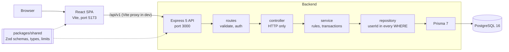
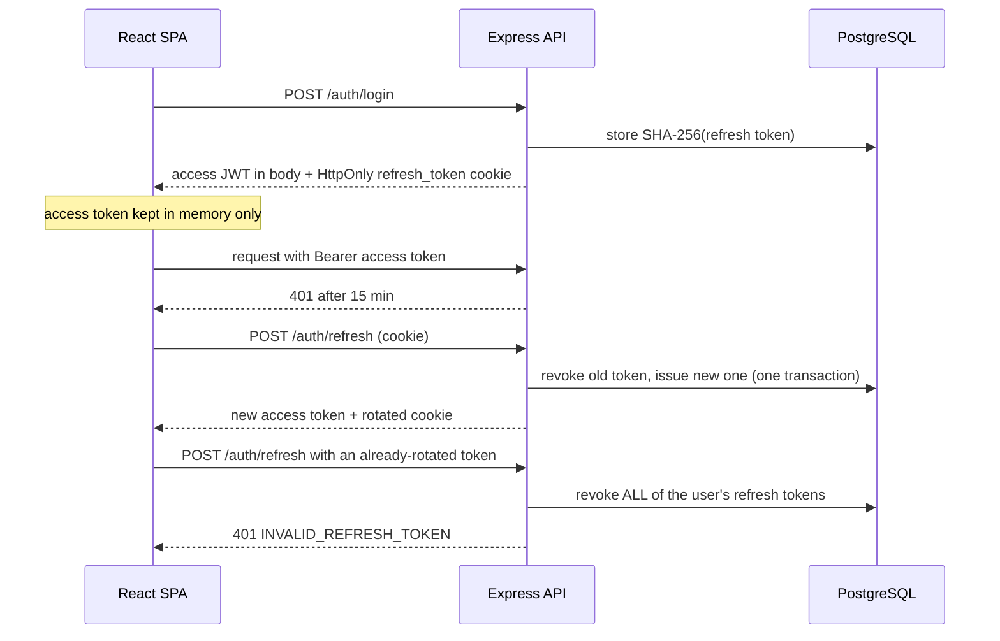

# Note Taking App

A full-stack note taking application built as a Spec-Driven Development (SDD) exercise. Users register and sign in, write rich-text notes, organise them with tags, search them with full-text search and highlighting, share them through public read-only links, and restore earlier versions. The backend is a layered Express 5 API over PostgreSQL 16 with Prisma 7; the frontend is a React 19 single-page app; both share one contract of Zod schemas. Every ticket (`AB-1001` to `AB-1016`) was specified in OpenSpec, approved, implemented against named scenarios, reviewed and merged in order.

Business truth lives in [`docs/FRS.md`](docs/FRS.md), technical truth in [`docs/SDS.md`](docs/SDS.md) (binding), and decisions in [`docs/decisions/`](docs/decisions).

## Features

- **Accounts:** register, login, logout, session restore on reload, and password reset with a one-time code (OTP).
- **Notes:** create, edit, delete with a 30-day trash and restore, pagination and sorting.
- **Rich text:** TipTap editor with an allow-listed document grammar and a 2-second debounced autosave.
- **Tags:** create, rename, delete, attach to notes, filter the note list by tag.
- **Search:** PostgreSQL full-text search with safely highlighted snippets.
- **Sharing:** many public read-only links per note, with expiry, revoke, and an atomic view counter.
- **Version history:** full snapshots on every change, newest 50 kept, restore creates a new version.

## Tech stack

Exact pinned versions, from [`docs/SDS.md`](docs/SDS.md) section 3. No `latest` tags or version ranges are used anywhere.

| Area | Technology | Version |
| --- | --- | --- |
| Runtime | Node.js | 22.21.0 (`.nvmrc`, `engines` is `22.x`) |
| Package manager | pnpm (workspaces) | 10.34.9 |
| Language | TypeScript | 6.0.3 |
| Backend | Express | 5.3.0 |
| Backend | Prisma + `@prisma/adapter-pg` | 7.10.1 |
| Backend | Zod (in `packages/shared`) | 4.6.7 |
| Backend | jose (JWT, HS256) | 6.2.13 |
| Backend | @node-rs/argon2 (Argon2id) | 2.2.2 |
| Backend | helmet / pino / pino-http | 8.3.0 / 10.4.0 / 11.0.0 |
| Database | PostgreSQL | 16.15 (`postgres:16.15-bookworm`) |
| Frontend | React / React DOM | 19.3.1 |
| Frontend | Vite | 8.3.5 |
| Frontend | react-router | 7.18.5 |
| Frontend | TanStack Query | 5.105.0 |
| Frontend | Zustand | 5.0.16 |
| Frontend | TipTap (react, core, pm, starter-kit) | 3.32.0 |
| Frontend | Tailwind CSS + shadcn/ui (CLI) | 4.3.3 + 4.23.0 |
| Frontend | react-hook-form / @hookform/resolvers | 7.91.0 / 6.0.2 |
| Tests | Vitest + coverage-v8 | 5.0.5 |
| Tests | Supertest | 7.3.1 |
| Tests | Testing Library (react) / msw | 16.3.3 / 2.15.0 |
| Tests | Playwright | 1.64.1 |
| Quality | ESLint / Prettier | 10.13.0 / 3.9.10 |
| Quality | husky / commitlint | 9.1.7 / 21.2.4 |
| Specs | OpenSpec CLI | 1.15.0 |

## Architecture



### Layering rule

Dependencies point one way: **routes** (validate input, authenticate) → **controller** (HTTP only) → **service** (business rules and transactions) → **repository** (the only code that touches Prisma). Services and controllers never call Prisma. Every repository method takes `userId` in its `WHERE`, so another user's resource and a missing one are both `404`, never `403`. `createApp({ prisma, clock, emailService, env })` receives its dependencies, so modules never import `env` or a Prisma singleton and time comes from an injected `Clock`. See [ADR-0001](docs/decisions/ADR-0001-layered-backend-architecture.md).

### Contract first: `packages/shared`

Every request and response is a Zod schema in `packages/shared`, and types are inferred from it. The backend validates input and parses output with these schemas; the frontend parses responses with them. Types and schemas are never redeclared in `backend/` or `frontend/`. Outside `shared`, `zod` is a type-only import, enforced by lint (the one exception is the backend `Env` schema, which is runtime configuration). See [ADR-0002](docs/decisions/ADR-0002-shared-contracts-and-esm-build.md).

### Authentication flow



- **Access token:** JWT HS256, 15 minutes, held in browser memory only.
- **Refresh token:** opaque 256-bit value, 7 days, stored only as a SHA-256 hash, **rotated on every use**, delivered only as an `HttpOnly` cookie `refresh_token` (`SameSite=Strict`, `Path=/api/v1/auth`, `Secure` in production).
- **Reuse detection:** presenting a token that was already rotated revokes every refresh token of that user and returns `401` (AC-AUTH-12).
- **CSRF:** `SameSite=Strict` plus an `Origin` check on `/auth/refresh` and `/auth/logout` (`403 FORBIDDEN_ORIGIN`).
- **Client:** `apiFetch` refreshes once on a `401`, with a single in-flight promise and the Web Locks API across tabs. See [ADR-0003](docs/decisions/ADR-0003-token-strategy.md).

## Repository structure

```text
.
├── backend/                 Express 5 API
│   ├── prisma/              schema.prisma and migrations/
│   ├── prisma.config.ts     Prisma 7 config (reads ../.env)
│   ├── src/
│   │   ├── app.ts           createApp(deps) factory (used by tests)
│   │   ├── server.ts        entry point
│   │   ├── config/          Zod-validated environment
│   │   ├── common/          errors, http helpers, security, logger, clock
│   │   ├── modules/         auth, email, health, notes, search, shares, tags, versions
│   │   ├── jobs/            trash purge and housekeeping, scheduler
│   │   └── testing/         test-only OTP sink
│   └── tests/               integration tests (Supertest, real Postgres)
├── frontend/                React 19 SPA
│   └── src/
│       ├── app/  routes/    providers, router, guards
│       ├── features/        auth, editor, health, notes, search, sharing, tags, trash, versions
│       ├── components/ui/   generated shadcn/ui (not hand-edited)
│       ├── lib/             api client, query client, helpers
│       └── test/            test setup and msw handlers
├── packages/shared/         Zod schemas, inferred types, limits (the only place types live)
├── e2e/                     Playwright tests, support/, .output/ (gitignored)
├── docker/postgres/         init-test.sql (creates noteapp_e2e)
├── docker-compose.yml       dev and test PostgreSQL containers
├── docs/
│   ├── FRS.md  SDS.md       requirements and design
│   ├── decisions/           ADR-0001 to ADR-0008
│   ├── api/openapi.yaml     API description
│   └── reference/           assignment and SDD guide
├── openspec/                config.yaml, specs/ (current behaviour), changes/ (active)
├── .claude/                 settings.json, agents/, commands/, hooks/, skills/
├── .github/workflows/       ci.yml
├── .husky/                  pre-commit and commit-msg hooks
├── scripts/                 check-scenarios.mjs, pre-commit.sh, tooling tests
├── AGENTS.md  CLAUDE.md     context for AI tools
└── .env.example             template for the root .env
```

## Getting started

### Prerequisites

- **Node.js 22** (22.21.0 in `.nvmrc`).
- **pnpm 10.34.9** through corepack: `corepack enable` then `corepack prepare pnpm@10.34.9 --activate`. The `packageManager` field pins it.
- **Docker** with Compose (runs PostgreSQL).

### Setup

```sh
git clone https://github.com/ankitmfsi22/note-taking-app.git
cd note-taking-app
cp .env.example .env
```

Edit `.env` and replace the two secrets. Generate each with `openssl rand -base64 48` (at least 32 bytes, and different from each other). Never commit `.env`.

```sh
pnpm install                                    # also runs prisma generate
pnpm db:up                                      # PostgreSQL 16 containers, waits until healthy
pnpm --filter backend exec prisma migrate deploy   # apply migrations to noteapp_dev
pnpm dev                                        # build shared, then run backend and frontend
```

| Service | URL |
| --- | --- |
| Frontend (Vite dev server) | http://localhost:5173 |
| Backend API | http://localhost:3000/api/v1 (health: `/api/v1/health`) |

The Vite dev server proxies `/api` to `VITE_API_PROXY_TARGET`, so the browser sees one origin.

**Where the OTP is logged.** There is no real email. A password-reset code is printed to the **backend console** as `password reset code for <email>: <code>`, whatever `LOG_LEVEL` is. Only when `NODE_ENV=test` it is also appended to `e2e/.output/otp.jsonl` (ADR-0004); that sink cannot be enabled elsewhere.

### Environment variables

Defined in `.env.example` and validated at startup by `backend/src/config/env.ts` (the process exits with a message on failure). The values in `.env.example` are for local containers only and are not secrets.

| Variable | Used by | Purpose |
| --- | --- | --- |
| `NODE_ENV` | backend | `development`, `test` or `production`. |
| `PORT` | backend | API port (default `3000`). |
| `LOG_LEVEL` | backend | pino log level (default `info`). |
| `DATABASE_URL` | backend, Prisma | PostgreSQL connection string. Dev: port 5432, database `noteapp_dev`. |
| `JWT_ACCESS_SECRET` | backend | Signs access tokens. At least 32 bytes. |
| `OTP_HMAC_SECRET` | backend | HMAC key for stored OTPs. At least 32 bytes, different from the JWT secret. |
| `APP_ORIGIN` | backend | Origin accepted by the Origin check on `/auth/refresh` and `/auth/logout`. |
| `COOKIE_SECURE` | backend | `true` in production so the refresh cookie is `Secure`. |
| `JOBS_ENABLED` | backend | Run background jobs (trash purge, housekeeping). `false` in tests. |
| `ARGON2_MEMORY_KIB` | backend | Argon2id memory cost (default 19456). Lower values are rejected in production. |
| `ARGON2_TIME_COST` | backend | Argon2id time cost (default 2). Lower values are rejected in production. |
| `VITE_API_PROXY_TARGET` | frontend dev | Backend URL the Vite proxy forwards `/api` to. |
| `OTP_TEST_FILE` | backend | Test-only OTP sink. Startup fails if set when `NODE_ENV` is not `test`. Not in `.env.example`; Playwright manages it. |

A git worktree should use its own dev database name in `DATABASE_URL`.

## Docker

[`docker-compose.yml`](docker-compose.yml) runs two PostgreSQL 16.15 containers:

| Service | Host port | Databases | Storage | Used for |
| --- | --- | --- | --- | --- |
| `db-dev` | 5432 | `noteapp_dev` | named volume `noteapp_dev_data` (persists) | `pnpm dev` |
| `db-test` | 5433 | `noteapp_test`, `noteapp_e2e` | `tmpfs` (wiped on stop) | integration tests and E2E |

`db-test` mounts [`docker/postgres/init-test.sql`](docker/postgres/init-test.sql), which creates `noteapp_e2e` on first start (`noteapp_test` is the container's default database). Both services have a `pg_isready` healthcheck, and `pnpm db:up` uses `--wait` so it returns once they are healthy.

```sh
pnpm db:up      # docker compose up -d --wait
pnpm db:down    # docker compose down (keeps the dev volume)
```

**Reset the dev data:** `docker compose down -v` removes the `noteapp_dev_data` volume, then run `pnpm db:up` and the migrate command again. The test database needs no reset, because its storage is a `tmpfs`.

## Scripts

Root `package.json` scripts:

| Script | What it does |
| --- | --- |
| `pnpm dev` | Builds `packages/shared`, then runs every package's `dev` in parallel (backend with `tsx watch`, frontend with Vite, shared in `tsc --watch`). |
| `pnpm build` | Builds all workspaces (shared first, then backend and frontend). |
| `pnpm typecheck` | Type-checks all workspaces. |
| `pnpm lint` | ESLint over the repository. CI runs it with `--max-warnings 0`. |
| `pnpm format` / `pnpm format:check` | Prettier write / check. |
| `pnpm test` | Runs Vitest in every package (unit, integration, component). Add `--coverage` for coverage. |
| `pnpm test:tooling` | Node tests for the repo scripts (`scripts/**/*.test.mjs`). |
| `pnpm test:e2e` | Playwright tests in `e2e/`. |
| `pnpm spec:validate` | `openspec validate --all --strict`. |
| `pnpm check:scenarios` | Fails unless every spec scenario ID has exactly one test. |
| `pnpm db:up` / `pnpm db:down` | Start / stop the Docker databases. |
| `pnpm prepare` | Installs the Husky hooks (runs on install). |
| `pnpm postinstall` | Runs `prisma generate` for the backend. |

Backend-only: `pnpm --filter backend run job:purge` runs the trash purge once; `pnpm --filter backend run start` runs the built server (`node dist/server.js`).

## Testing

| Layer | Tooling | Location | Database |
| --- | --- | --- | --- |
| Unit | Vitest | `*.test.ts` next to the code, in each package | none |
| Integration | Vitest + Supertest, through `createApp()` | `backend/tests/integration/` | real PostgreSQL, `noteapp_test` on port 5433 |
| Component | Vitest + Testing Library + msw | `*.test.tsx` in `frontend/` | none (network mocked) |
| E2E | Playwright, Chromium | `e2e/tests/` | `noteapp_e2e` on port 5433 |

```sh
pnpm db:up                 # integration and E2E need the test database
pnpm test                  # unit + integration + component
pnpm test --coverage       # with coverage
pnpm test:e2e              # E2E
pnpm check:scenarios       # scenario coverage
```

- **Integration** tests apply the Prisma migrations to `noteapp_test` once per run and truncate tables between tests. Time-dependent tests inject a fake `Clock`; tests never sleep.
- **E2E** starts its own backend (port 3100, `NODE_ENV=test`) and frontend (port 5174), applies migrations to `noteapp_e2e`, and truncates it before each test with one worker. It reads password-reset codes from `e2e/.output/otp.jsonl`, never from console output.
- **Coverage:** thresholds of 80% (lines, functions, branches, statements) are set per package, so `pnpm test --coverage` fails below them.
- **One test per scenario:** every OpenSpec scenario has an ID `S-AB<ticket>-<nn>`, and the test title starts with it. `pnpm check:scenarios` fails on a scenario with no test, with more than one, or on a test with an unknown ID.

## API overview

Base path `/api/v1`, JSON only. The full description is in [`docs/api/openapi.yaml`](docs/api/openapi.yaml); status and error codes are binding in [`docs/SDS.md`](docs/SDS.md) section 7.

**Error body:**

```json
{ "error": { "code": "NOTE_NOT_FOUND", "message": "...", "details": {}, "requestId": "..." } }
```

`details` is optional. Used statuses: 200, 201, 204, 400, 401, 403 (Origin check only), 404, 409, 413, 500. Ownership failures are always `404`. Lists use `?page&pageSize` (defaults 1 and 20, max 100) and return `{ items, page, pageSize, total, totalPages }`.

*Auth:* **none** = public, **Bearer** = access token, **Cookie** = refresh cookie plus Origin check.

| Method | Path | Auth | Purpose |
| --- | --- | --- | --- |
| GET | `/health` | none | Health check |
| POST | `/auth/register` | none | Create an account, start a session |
| POST | `/auth/login` | none | Sign in |
| POST | `/auth/refresh` | Cookie | Rotate the refresh token, get a new access token |
| POST | `/auth/logout` | Cookie | Revoke the refresh token, clear the cookie |
| POST | `/auth/forgot-password` | none | Send a reset OTP (identical response for unknown emails) |
| POST | `/auth/reset-password` | none | Reset the password with the OTP |
| POST | `/notes` | Bearer | Create a note |
| GET | `/notes` | Bearer | List notes (pagination, sort, tag filter) |
| GET | `/notes/trash` | Bearer | List trashed notes |
| GET | `/notes/:noteId` | Bearer | Read a note |
| PATCH | `/notes/:noteId` | Bearer | Update a note |
| DELETE | `/notes/:noteId` | Bearer | Move a note to the trash |
| POST | `/notes/:noteId/restore` | Bearer | Restore a note from the trash |
| PUT | `/notes/:noteId/tags` | Bearer | Replace a note's tags |
| GET | `/tags` | Bearer | List tags with note counts |
| POST | `/tags` | Bearer | Create a tag |
| PATCH | `/tags/:tagId` | Bearer | Rename a tag |
| DELETE | `/tags/:tagId` | Bearer | Delete a tag |
| GET | `/search` | Bearer | Full-text search with highlights |
| POST | `/notes/:noteId/shares` | Bearer | Create a share link |
| GET | `/notes/:noteId/shares` | Bearer | List a note's share links |
| GET | `/shares` | Bearer | List all active share links |
| POST | `/shares/:shareId/revoke` | Bearer | Revoke a share link (idempotent) |
| GET | `/public/shares/:token` | none | Read a shared note |
| GET | `/notes/:noteId/versions` | Bearer | List versions |
| GET | `/notes/:noteId/versions/:versionNumber` | Bearer | Read one version |
| POST | `/notes/:noteId/versions/:versionNumber/restore` | Bearer | Restore a version (creates a new one) |

## Development workflow (SDD)

Every ticket follows the same path, defined in [`CLAUDE.md`](CLAUDE.md) and [`docs/reference/SDD-GUIDE.md`](docs/reference/SDD-GUIDE.md):

1. **Spec:** an OpenSpec change (proposal, delta spec with `S-ABxxxx-nn` scenarios, `delta-openapi.yaml`).
2. **Approval:** a human approves the spec (`/approve`, recorded in `approvals.md`). No production code without it.
3. **Design and tasks:** `design.md` and `tasks.md`, with `[PARALLEL]` markers.
4. **Tests first,** then the implementation, phase by phase.
5. **Checkpoint** after each phase: `pnpm build`, `pnpm lint --max-warnings 0`, `pnpm test`. A failing checkpoint stops the work.
6. **Review** in a fresh session by the read-only `reviewer` agent (spec and FRS compliance).
7. **Archive:** `openspec archive` merges the change into `openspec/specs/`.
8. **PR and CI,** then the human PR review and merge, in ticket order.

**Commits:** `type(scope): description AB#ticket`, for example `feat(auth): add login AB#1002`. Scope and the `AB#` reference are required.
**Branches:** `feature/{domain}/AB-{ticket}-{short-name}`.
**Hooks:** Husky `pre-commit` runs `scripts/pre-commit.sh` (docs, specs and markdown-only commits get `prettier --check`; code commits run typecheck, lint, tests, tooling tests and spec validation). `commit-msg` runs commitlint with [`commitlint.config.mjs`](commitlint.config.mjs). Never use `--no-verify`, force-push, or push to `main`.

### Claude Code commands

| Command | Purpose |
| --- | --- |
| `/spec AB-xxxx` | Write the OpenSpec proposal, delta spec and `delta-openapi.yaml`, then stop for review |
| `/approve` | Record the human spec approval in `approvals.md` |
| `/sdd-plan AB-xxxx` | Write `design.md` from the approved spec |
| `/sdd-tasks AB-xxxx` | Write `tasks.md` with `[PARALLEL]` markers |
| `/implement AB-xxxx` | Implement phase by phase with checkpoints, committing each green phase |
| `/parallel AB-xxxx` | Run `[PARALLEL]` tasks in separate git worktrees |
| `/sdd-review AB-xxxx` | Read-only review against spec, FRS and SDS, in a fresh terminal |
| `/pr AB-xxxx` | Archive the change, then open the PR (only after an all-green review) |

### Agents, skills, hooks, Context7

- **Agents** (`.claude/agents/`): `reviewer` (read-only: Read, Grep, Glob, Bash) and `test-writer` (writes tests only, never production code).
- **Skills** (`.claude/skills/`): `add-endpoint` and `spec-scenario-format`.
- **Hooks** (`.claude/hooks/`, wired in `.claude/settings.json`): `guard-bash.mjs` blocks force-push, pushes to `main`, `--no-verify`, `@latest`, and writing files through the shell; `guard-files.mjs` guards file writes. `settings.json` also denies reading `.env` files.
- **Context7:** configured in `.mcp.json` (`pnpm exec context7-mcp`) so every library API is checked against live documentation instead of being guessed.

## Continuous integration

[`.github/workflows/ci.yml`](.github/workflows/ci.yml) runs on pull requests and on pushes to `feature/**`. It never pushes, and every action is pinned to a full commit SHA.

| Job | What it checks |
| --- | --- |
| `verify` | With a `postgres:16.15` service on port 5433: `pnpm install --frozen-lockfile`, `pnpm build`, `pnpm lint --max-warnings 0`, `pnpm format:check`, `pnpm test --coverage`, `pnpm test:tooling`, `pnpm spec:validate`, `pnpm check:scenarios`. |
| `e2e` | Builds `packages/shared`, installs Chromium, runs `pnpm test:e2e` against a `noteapp_e2e` service; uploads the Playwright report on failure. |
| `security` | `pnpm audit --audit-level=high`, then a checksum-verified gitleaks v8.30.1 scan of the full git history. |
| `commits` | Pull requests only: `commitlint` over every commit from the base to the head (Rule 14). |

## Security notes

- **Passwords:** Argon2id (`@node-rs/argon2`), 8 to 128 characters, never logged or returned.
- **Refresh tokens:** opaque, 256-bit, stored only as SHA-256, rotated on every use, with reuse detection that revokes all of a user's tokens.
- **OTP:** 6 digits, 10 minutes, single use, 5 attempts, stored as HMAC-SHA256 and compared in constant time. Responses do not reveal whether an email exists.
- **CSRF:** `SameSite=Strict` cookie scoped to `/api/v1/auth` plus an Origin check on the cookie endpoints.
- **Access token** lives in memory only; it is never written to storage.
- **No `innerHTML`:** search highlights are escaped on the server with random-nonce markers and rendered by the client as text nodes. Stored rich text is limited to an allow-list, and link protocols to `http`, `https` and `mailto`.
- **Soft delete:** a note is only marked with `deletedAt`, stays restorable for 30 days, and is purged only when `deletedAt <= now - 30 days`.
- **Ownership:** `userId` is in every repository query; foreign resources return `404`.
- **SQL:** Prisma queries and tagged-template raw SQL only; `$queryRawUnsafe` is banned by lint.
- **Secrets never logged:** pino redacts the authorization header, cookies, passwords, OTPs and refresh tokens; request bodies are not logged. The OTP appears only in the console line and the test-only file.
- **Supply chain:** exact dependency versions, SHA-pinned CI actions, `pnpm audit` and gitleaks in CI.

## Project status

All 16 tickets are merged. Pull requests are in [ankitmfsi22/note-taking-app](https://github.com/ankitmfsi22/note-taking-app/pulls).

| Ticket | Scope | Status | PR |
| --- | --- | --- | --- |
| AB-1001 | Project setup | Merged | [#2](https://github.com/ankitmfsi22/note-taking-app/pull/2) |
| AB-1002 | Auth: register, login, refresh, logout | Merged | [#3](https://github.com/ankitmfsi22/note-taking-app/pull/3) |
| AB-1003 | Auth: forgot password + OTP reset | Merged | [#4](https://github.com/ankitmfsi22/note-taking-app/pull/4) |
| AB-1004 | Notes: CRUD, soft delete, trash | Merged | [#5](https://github.com/ankitmfsi22/note-taking-app/pull/5) |
| AB-1005 | Notes: pagination, sorting, tag filter | Merged | [#6](https://github.com/ankitmfsi22/note-taking-app/pull/6) |
| AB-1006 | Tags: CRUD, note counts | Merged | [#7](https://github.com/ankitmfsi22/note-taking-app/pull/7) |
| AB-1007 | Search: full-text with highlight | Merged | [#8](https://github.com/ankitmfsi22/note-taking-app/pull/8) |
| AB-1008 | Sharing: links, revoke, public read | Merged | [#9](https://github.com/ankitmfsi22/note-taking-app/pull/9) |
| AB-1009 | Version history + restore | Merged | [#11](https://github.com/ankitmfsi22/note-taking-app/pull/11) |
| AB-1010 | Frontend: auth pages | Merged | [#10](https://github.com/ankitmfsi22/note-taking-app/pull/10) |
| AB-1011 | Frontend: notes list | Merged | [#15](https://github.com/ankitmfsi22/note-taking-app/pull/15) |
| AB-1012 | Frontend: editor + autosave | Merged | [#14](https://github.com/ankitmfsi22/note-taking-app/pull/14) |
| AB-1013 | Frontend: search UI | Merged | [#12](https://github.com/ankitmfsi22/note-taking-app/pull/12) |
| AB-1014 | Frontend: share modal, links, public page | Merged | [#13](https://github.com/ankitmfsi22/note-taking-app/pull/13) |
| AB-1015 | Frontend: version drawer | Merged | [#16](https://github.com/ankitmfsi22/note-taking-app/pull/16) |
| AB-1016 | E2E: Playwright journey | Merged | [#17](https://github.com/ankitmfsi22/note-taking-app/pull/17) |

## Decisions and deviations

**Architecture decisions** are recorded as ADRs in [`docs/decisions/`](docs/decisions):

- [ADR-0001](docs/decisions/ADR-0001-layered-backend-architecture.md) layered backend architecture
- [ADR-0002](docs/decisions/ADR-0002-shared-contracts-and-esm-build.md) shared contracts and ESM build
- [ADR-0003](docs/decisions/ADR-0003-token-strategy.md) token strategy
- [ADR-0004](docs/decisions/ADR-0004-otp-delivery-and-test-only-sink.md) OTP delivery and the test-only sink
- [ADR-0005](docs/decisions/ADR-0005-soft-delete-and-trash-purge.md) soft delete and trash purge
- [ADR-0006](docs/decisions/ADR-0006-fulltext-search-and-safe-highlighting.md) full-text search and safe highlighting
- [ADR-0007](docs/decisions/ADR-0007-version-history-snapshots.md) version history snapshots
- [ADR-0008](docs/decisions/ADR-0008-share-links-and-atomic-view-count.md) share links and atomic view count

**Deviations from the intended process**, stated plainly:

- **Two human gates after AB-1003.** Because of the deadline, tickets after AB-1003 follow the SDD guide: only the spec approval and the PR review are human gates. Design and tasks are still written, but have no approval gate.
- **Backend and frontend in parallel on two machines (Rule 7).** Backend and frontend tickets were built at the same time on two machines, each ticket on its own branch and worktree, and merged in ticket order.
- **PR #1 was merged by mistake.** The AB-1001 setup branch was merged into `main` through PR #1 (2026-10-28) when that was not intended. Project setup is tracked under PR #2 in the status table.
- **UUIDv4 backfill.** Ids the application creates use UUIDv7, but the one-time version-1 backfill in the `versions_note_version` migration uses `gen_random_uuid()` (UUIDv4), because PostgreSQL 16 has no built-in `uuidv7()`. The owner accepted this exception on 2026-10-29 (recorded in `openspec/changes/ab-1009-versions/design.md`).

## Out of scope

Real-time collaboration, file attachments, a mobile app, OAuth, folders or nesting, real email delivery (the OTP is only logged to the console), and login throttling. Building any of these would be a violation of the brief.

## Troubleshooting

| Problem | Fix |
| --- | --- |
| `Port 5173 is already in use` | The Vite dev server uses `strictPort`, so it will not pick another port. Stop the other process on 5173. |
| Backend fails to start on port 3000 | Another process uses it. Stop it, or change `PORT` and `VITE_API_PROXY_TARGET` together. |
| `pnpm db:up` fails or hangs | Docker is not running, or port 5432 or 5433 is taken (for example by a local PostgreSQL). Start Docker, stop the conflicting service, retry. |
| Backend tests: `prisma migrate deploy failed against the test database` | `db-test` is not running. Run `pnpm db:up`. |
| Playwright fails to start a server | E2E uses ports 3100 and 5174 and does not reuse servers. Free them. |
| Startup exits with an env validation message | A required variable in `.env` is missing, or a secret is under 32 bytes or the two secrets are equal. Compare with `.env.example`. |
| Wrong pnpm version or `packageManager` error | Run `corepack enable` and `corepack prepare pnpm@10.34.9 --activate`. Check Node with `node -v` (22.x). |
| Dev data looks stale or broken | `docker compose down -v`, then `pnpm db:up` and the migrate command. |
