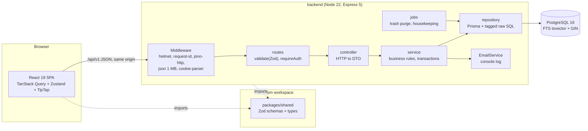
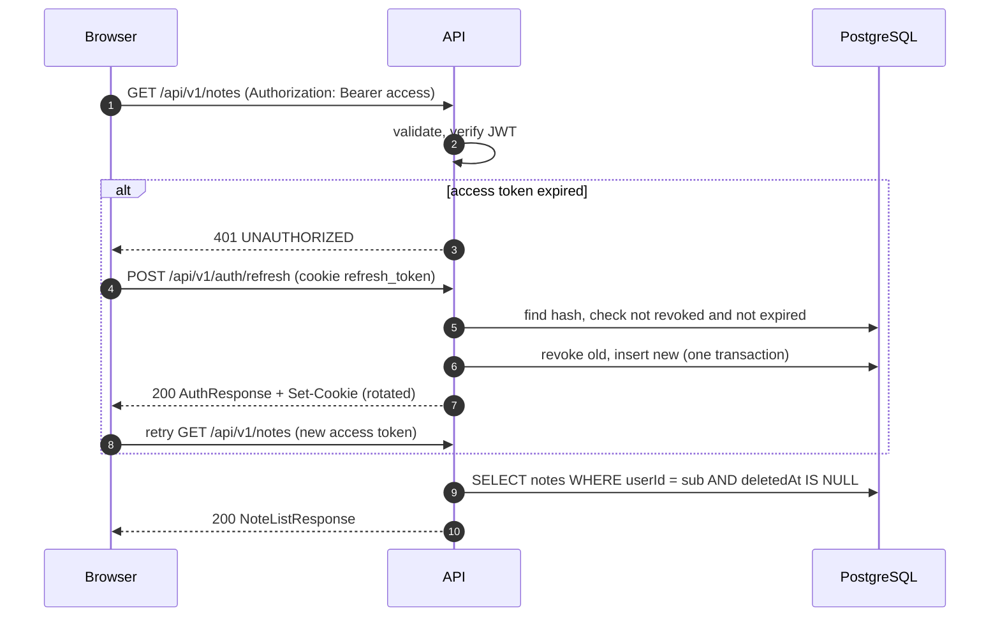
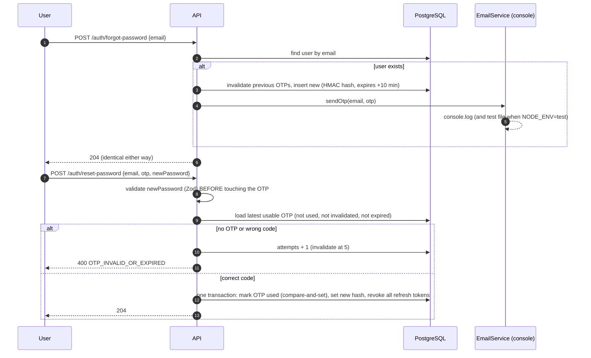

# Software Design Specification (SDS) — Note Taking App

| Field | Value |
| --- | --- |
| Status | DRAFT — awaiting human approval (Gate: SDS review) |
| Written | 2026-10-28 |
| Inputs | `docs/FRS.md` (approved, commit `e29d14a`), `docs/reference/ASSIGNMENT.md` (wins on conflict) |
| Tickets covered | AB-1001 to AB-1016 |
| Companion files | `docs/api/openapi.yaml` (baseline), `docs/decisions/ADR-0001` to `ADR-0008` |

This document says **how** the system is built. It does not add business rules: every behaviour traces to an FRS requirement. Anything the FRS does not decide is marked **[ASSUMPTION — confirm]** with an ID `(SA-nn)`, and all are listed in [Section 14](#14-assumptions-to-confirm). FRS assumptions keep their `A-nn` IDs.

Per-ticket specs (`openspec/changes/AB-xxxx-*/`) SHALL NOT contradict this document. The HTTP status codes and error codes in Section 7 are **binding for every ticket**.

---

## 1. Architecture overview

A single-page React app talks JSON over HTTP to a stateless Express 5 API. The API holds all business rules and talks to one PostgreSQL 16 database through Prisma. There are no other services: search is PostgreSQL full-text search and "email" is a console log.



### 1.1 Principles

1. **Contract first.** Every request and response shape is a Zod schema in `packages/shared` (Rule 11). The backend validates input and parses output with it. The frontend parses responses with it. Nothing is redefined elsewhere.
2. **Layers do one thing.** `routes → controller → service → repository` (ADR-0001). Only repositories touch Prisma. Only services hold business rules. Controllers know HTTP and nothing else.
3. **Ownership in the query.** Every repository method takes `userId` and puts it in the `WHERE` clause (FR-X-1). A foreign or missing resource is the same `404`.
4. **Stateless API.** No server session. Access token is a JWT. The only server-side auth state is the hashed refresh token and OTP rows.
5. **One transaction per invariant.** Note save + version snapshot (AC-VER-11), tag replacement, OTP reset and restore all run in a single database transaction.

### 1.2 Request lifecycle

1. **Edge.** `helmet()` sets security headers. `pino-http` assigns `X-Request-Id` and logs the request with secrets redacted. `express.json({ limit: '1mb' })` parses the body. `cookie-parser` reads the refresh cookie.
2. **Route.** The router matches. `validate({ params, query, body })` runs the shared Zod schemas. Failure becomes `400 VALIDATION_ERROR`. Parsed values go to `res.locals.valid` (Express 5 makes `req.query` a read-only getter, so it cannot be reassigned).
3. **Auth.** `requireAuth` verifies the Bearer JWT with `jose` and sets `res.locals.userId`. Failure is `401 UNAUTHORIZED`.
4. **Controller.** Reads `res.locals`, calls one service method, and maps the result to the response DTO. The DTO is parsed with the shared response schema before `res.json`, which strips any extra field (for example `passwordHash`).
5. **Service.** Applies business rules, opens a transaction where needed, throws a typed `AppError` on a rule failure.
6. **Repository.** Runs Prisma queries or tagged-template raw SQL, always scoped by `userId`.
7. **Errors.** Express 5 forwards a rejected async handler to the error middleware. It maps `AppError`, `ZodError`, body-parser errors and unknown errors to the single error shape in Section 4. Unknown errors become `500 INTERNAL_ERROR` with no detail leaked and the stack logged with the request ID.



---

## 2. Monorepo layout

```text
note-app/
├── backend/                     # Express 5 API (ESM, tsc build)
├── frontend/                    # React 19 SPA (Vite)
├── packages/
│   └── shared/                  # Zod schemas + inferred types + limits (the contract)
├── e2e/                         # Playwright tests
├── docs/                        # FRS, SDS, api/, decisions/, reference/
├── openspec/                    # config.yaml, specs/, changes/ (+ archive/)
├── scripts/                     # check-scenarios.mjs, pre-commit.sh
├── .claude/                     # settings.json, agents/, commands/, skills/, hooks/
├── .github/workflows/ci.yml
├── .husky/                      # pre-commit, commit-msg
├── docker-compose.yml           # postgres dev + test
├── AGENTS.md  CLAUDE.md  .mcp.json  .nvmrc
├── commitlint.config.mjs  eslint.config.mjs  prettier.config.mjs
├── tsconfig.base.json
├── package.json  pnpm-workspace.yaml  pnpm-lock.yaml
└── .env.example
```

`pnpm-workspace.yaml` lists `backend`, `frontend`, `e2e` and `packages/*`, keeps `savePrefix: ''`, and carries the `onlyBuiltDependencies` allow-list for packages that need install scripts. **[ASSUMPTION — confirm]** (SA-47)

### 2.1 `backend/`

```text
backend/
├── prisma/
│   ├── schema.prisma
│   └── migrations/                  # one or more per ticket (Section 6.4)
├── prisma.config.ts                 # imports dotenv, datasource url from DATABASE_URL
├── src/
│   ├── server.ts                    # entry: load env, build deps, listen, start jobs
│   ├── app.ts                       # createApp(deps): Express app factory (used by tests)
│   ├── config/env.ts                # Zod-validated environment (fails fast)
│   ├── common/
│   │   ├── errors/                  # AppError, error codes -> status map, error middleware
│   │   ├── http/                    # validate(), requireAuth, origin-check, asyncless helpers
│   │   ├── db/prisma.ts             # PrismaClient + PrismaPg adapter
│   │   ├── security/                # tokens.ts (jwt, refresh, share token), hash.ts (argon2, hmac)
│   │   ├── logger.ts                # pino + redaction
│   │   └── clock.ts                 # Clock interface (injected for time-dependent logic)
│   ├── modules/
│   │   ├── health/
│   │   ├── auth/                    # AB-1002, AB-1003
│   │   ├── email/                   # EmailService interface + ConsoleEmailService
│   │   ├── notes/                   # AB-1004, AB-1005 (+ content-text.ts)
│   │   ├── tags/                    # AB-1006
│   │   ├── search/                  # AB-1007
│   │   ├── shares/                  # AB-1008 (owner + public routes)
│   │   └── versions/                # AB-1009
│   ├── jobs/                        # trash-purge.job.ts, housekeeping.job.ts, scheduler.ts
│   ├── testing/otp-test-sink.ts     # NODE_ENV=test only (ADR-0004)
│   └── generated/prisma/            # prisma generate output (gitignored)
├── tests/
│   ├── setup/                       # global-setup.ts (migrate deploy), db.ts (truncate)
│   └── integration/<module>/*.test.ts
├── vitest.config.ts
├── tsconfig.json  tsconfig.build.json
└── package.json
```

Each module folder holds `<module>.routes.ts`, `<module>.controller.ts`, `<module>.service.ts`, `<module>.repository.ts` and colocated `*.test.ts` unit tests.

**Wiring rule.** `createApp(deps)` receives `{ prisma, clock, emailService, env }` so integration tests inject a fake clock and a spy email service. Modules never import `env` or the Prisma singleton directly.

### 2.2 `frontend/`

```text
frontend/
├── src/
│   ├── main.tsx  app/                 # providers (QueryClient, Router), error boundary
│   ├── routes/                        # router.tsx, guards (RequireAuth, GuestOnly), layouts
│   ├── features/
│   │   ├── auth/                      # AB-1010: pages, forms, api, session store, refresh
│   │   ├── notes/                     # AB-1011: list page, trash view; AB-1012: editor/
│   │   ├── tags/                      # tag manager, tag picker, tag filter
│   │   ├── search/                    # AB-1013: search box, results, highlight parser
│   │   ├── sharing/                   # AB-1014: share modal, active links page, public page
│   │   └── versions/                  # AB-1015: version drawer
│   ├── components/ui/                 # shadcn/ui generated components (not hand-edited)
│   ├── lib/                           # api-client.ts, query-client.ts, format.ts, utils.ts
│   ├── hooks/                         # useDebouncedValue, ...
│   └── test/                          # setup.ts, msw handlers, render helpers
├── index.html  vite.config.ts  components.json  tsconfig*.json
└── package.json
```

Inside a feature: `api.ts` (fetch functions returning shared-schema types), `queries.ts` (TanStack hooks and query keys), `components/`, `pages/`, `*.test.tsx`.

### 2.3 `packages/shared/`

```text
packages/shared/
├── src/
│   ├── index.ts                      # barrel
│   ├── constants/limits.ts           # TITLE_MAX=200, TRASH_RETENTION_DAYS=30, VERSION_KEEP=50, ...
│   ├── schemas/
│   │   ├── common.ts                 # ids, pagination, ErrorResponse, ErrorCode
│   │   ├── auth.ts  note.ts  tag.ts  search.ts  share.ts  version.ts  health.ts
│   │   └── tiptap.ts                 # TipTapDocSchema (allow-list grammar)
│   └── types.ts                      # z.infer exports
├── tsconfig.json  package.json (exports -> dist)
└── CLAUDE.md
```

Shared holds **only** schemas, inferred types and numeric/string limits that the schemas reference. No business logic, no React, no Prisma.

### 2.4 `e2e/`

```text
e2e/
├── tests/                  # journey.spec.ts, password-reset.spec.ts, errors.spec.ts
├── support/                # fixtures.ts (db reset), otp-file.ts (reads test OTP file)
├── .output/                # otp.jsonl (gitignored)
├── playwright.config.ts
└── package.json
```

---

## 3. Technology stack and pinned versions

All versions are **exact** (Rule 20). `pnpm-workspace.yaml` has `savePrefix: ''`, so every `pnpm add` writes an exact version. Versions were read from the npm registry on 2026-10-28 and checked against Context7 library docs. Where the registry's `latest` is not usable, the pin differs on purpose (Section 3.4).

### 3.1 Runtime and tooling (root)

| Tool | Version | Reason |
| --- | --- | --- |
| Node.js | 22.21.0 (`.nvmrc`) | Fixed by the assignment (Node 22). Matches the dev machine. |
| pnpm | 10.34.9 (`packageManager`) | Already decided. |
| TypeScript | 6.0.3 | Latest line supported by typescript-eslint (`<6.1.0`). See 3.4. |
| @types/node | 22.20.5 | Types must match the Node 22 runtime. |
| tsx | 4.23.15 | Dev runner for backend and scripts. |
| ESLint | 10.13.0 | Flat config. Node 22.21 satisfies `^22.13`. |
| @eslint/js | 10.0.1 | Recommended rule set. |
| typescript-eslint | 8.72.1 | Typed linting with `projectService`. Peers: eslint 10, typescript below 6.1. |
| eslint-plugin-react-hooks | 7.1.1 | Hooks rules (frontend). |
| eslint-plugin-react-refresh | 0.5.7 | Vite fast-refresh rule (frontend). |
| globals | 17.13.0 | Environment globals for flat config. |
| Prettier | 3.9.10 | Formatting. |
| eslint-config-prettier | 10.1.8 | Turns off rules that clash with Prettier. |
| husky | 9.1.7 | Git hooks (`prepare: "husky"`). |
| @commitlint/cli | 21.2.4 | Commit message lint. |
| @commitlint/config-conventional | 21.2.4 | Conventional commit base rules. |
| @fission-ai/openspec | 1.15.0 | Already installed. |
| @upstash/context7-mcp | 4.4.4 | Already installed. |

### 3.2 Backend (`backend/`, `packages/shared/`)

| Package | Version | Reason | Context7 check |
| --- | --- | --- | --- |
| express | 5.3.0 | Fixed by the assignment. Native async error forwarding. | Verified: `req.query` is a getter; default query parser is `simple`; `req.body` is not pre-initialised; router handles rejected promises. |
| @types/express | 5.0.6 | Types for Express 5. | Registry. |
| zod | 4.6.7 (shared) | Single source of validation and types (Rule 11). | Verified: `z.iso.datetime`, `z.flattenError`, `z.infer`, recursive getters. |
| @prisma/client | 7.10.1 | Fixed by the assignment (Prisma ORM). | Verified: v7 requires a driver adapter; client imports from the generated folder. |
| prisma (CLI) | 7.10.1 | Must match the client. | Verified: `prisma.config.ts`, `migrate dev --create-only`. |
| @prisma/adapter-pg | 7.10.1 | Mandatory driver adapter in Prisma 7. | Verified: `new PrismaPg({ connectionString })`. |
| pg | 8.23.1 | Driver used by the adapter. Also used by `e2e` for DB reset. | Registry (adapter dependency). |
| @types/pg | 8.23.1 | Types for `pg`. | Registry. |
| dotenv | 18.0.9 (dev) | Prisma 7 does not load `.env` itself; `prisma.config.ts` imports it. | Verified in Prisma docs. |
| jose | 6.2.13 | JWT sign and verify with algorithm allow-list. Zero dependencies. | Verified: `SignJWT`, `jwtVerify`, `JWTExpired`. |
| @node-rs/argon2 | 2.2.2 | Argon2id password hashing. Prebuilt, no install script. No 72-byte limit (FRS allows 128 characters; bcrypt would truncate). | Verified: `hash`, `verify`, `parseOptions`, options. See SA-47 on the `const enum`. |
| helmet | 8.3.0 | Security headers. | Verified: defaults, CSP and Referrer-Policy options. |
| cookie-parser | 1.4.7 | Reads the refresh cookie. | Pattern seen in supertest docs. |
| @types/cookie-parser | 1.4.10 | Types. | Registry. |
| pino | 10.4.0 | Structured logs with redaction. | Verified: `redact` paths, censor, remove. |
| pino-http | 11.0.0 | Request logging and request ID. | Verified: `genReqId`, `customProps`, shared logger. |
| pino-pretty | 13.2.0 (dev) | Readable dev logs. | Registry. |

Not added on purpose: `cors` (same-origin, SA-01), `dotenv` in runtime (Node 22 `--env-file`), `express-async-errors` (Express 5 does it), `bcrypt`, `jsonwebtoken`, `uuid` (Prisma generates IDs; Node has `crypto`), `node-cron` (SA-23), `axios`, `lodash`, a rate-limit library (out of scope per FRS 13).

### 3.3 Frontend (`frontend/`)

| Package | Version | Reason | Context7 check |
| --- | --- | --- | --- |
| react / react-dom | 19.3.1 | Fixed by the assignment. | Registry. |
| @types/react / @types/react-dom | 19.3.0 | Types. | Registry. |
| vite | 8.3.5 | Fixed by the assignment. Node `^22.12` satisfied. | Verified: proxy config, `chunkSizeWarningLimit`, `manualChunks` object form removed. |
| @vitejs/plugin-react | 6.1.2 | React plugin. Peer is `vite ^8`. | Registry peers. |
| react-router | 7.18.5 | Routing, route guards, `useBlocker`. | Verified: `createBrowserRouter`, `redirect`, `useBlocker`. |
| @tanstack/react-query | 5.105.0 | Fixed by the assignment. | Verified: object syntax, `invalidateQueries`, `placeholderData: keepPreviousData`. |
| zustand | 5.0.16 | Fixed by the assignment. | Verified: `create<State>()(...)`, `getState`, `useShallow`. |
| @tiptap/react, @tiptap/core, @tiptap/pm, @tiptap/starter-kit | 3.32.0 each | Fixed by the assignment (TipTap). `core` and `pm` are required peers. StarterKit 3 includes link and underline. | Verified: `useEditor`, `StarterKit.configure`, `setContent`, `immediatelyRender`. |
| tailwindcss, @tailwindcss/vite | 4.3.3 each | Required by shadcn/ui (v4 CLI path). | Verified: Vite plugin and `@import "tailwindcss"`. |
| shadcn (CLI, run with `pnpm dlx`) | 4.23.0 | Fixed by the assignment. Copies components into `src/components/ui`. Never `@latest`. | Registry: 4.23.0 exists and is `latest`. Context7 (docs up to 4.21, shown as `@latest`): `init` for an existing project needs Tailwind and the `@/*` alias first and takes `--cwd`, `--base <base|radix|aria>` and `--yes`; `add` takes `--cwd`, `--yes`, `--dry-run`. We run `init --cwd frontend --base radix --yes` and `add <name> --cwd frontend --yes`. The `radix` base is our choice. **[ASSUMPTION — confirm]** (SA-47) |
| radix-ui or other primitives, class-variance-authority 0.7.1, clsx 2.1.1, tailwind-merge 3.7.0, lucide-react 1.63.0, sonner 2.0.8 | as added by the shadcn init | Dependencies of the generated components. The CLI installs them through pnpm, so they are pinned exactly by `savePrefix`. | Versions from registry. **[ASSUMPTION — confirm]** (SA-47) |
| react-hook-form | 7.91.0 | Form state for auth and tag forms (shadcn `Form` is built on it). | Registry. |
| @hookform/resolvers | 6.0.2 | `zodResolver` for shared Zod schemas (AC-FEAUTH-02). | Verified: Zod 4 overloads. |

Not added on purpose: a date library (`Intl.DateTimeFormat` and `Intl.RelativeTimeFormat` are enough), `lodash` (a 10-line debounce hook), `axios` (a typed `fetch` wrapper), `DOMPurify` (highlight parser renders no HTML, SA-34), a global CSS-in-JS library.

### 3.4 Test tooling

| Package | Version | Where | Reason | Context7 check |
| --- | --- | --- | --- | --- |
| vitest | 5.0.5 | all packages | Fixed by the assignment. Node `^22.12` satisfied. | Verified: v8 coverage thresholds, `exclude`, `setupFiles`. |
| @vitest/coverage-v8 | 5.0.5 | all packages | Coverage. Must equal Vitest. | Verified. |
| supertest | 7.3.1 | backend | Fixed by the assignment. | Verified: `request.agent` keeps cookies, `.bearer()`. |
| @types/supertest | 7.2.1 | backend | Types. | Registry. |
| @playwright/test | 1.64.1 | e2e | Fixed by the assignment. | Verified: `webServer`, `workers`, fixtures. |
| jsdom | 29.1.1 | frontend | DOM for component tests. `^22.13` satisfied. | Registry engines. |
| @testing-library/react | 16.3.3 | frontend | Component tests. | Registry. |
| @testing-library/dom | 10.4.2 | frontend | Required peer of RTL 16. | Registry peers. |
| @testing-library/user-event | 14.6.8 | frontend | Realistic input events. | Registry. |
| @testing-library/jest-dom | 7.0.1 | frontend | DOM matchers via `@testing-library/jest-dom/vitest`. | Verified: Vitest setup import. |
| msw | 2.15.0 | frontend | Network mocking in component tests. | Verified: `setupServer`, `http`, `HttpResponse`. |
| pg | 8.23.1 | e2e | Truncate tables between E2E tests (SA-45). | Registry. |

### 3.5 Where the pin differs from the registry `latest`

| Package | Registry `latest` | Pinned | Reason |
| --- | --- | --- | --- |
| prisma (CLI) | 8.0.0-rc.28 (a release candidate) | 7.10.1 | Stable line. `@prisma/client` and the adapter are 7.10.1. |
| typescript | 7.0.2 | 6.0.3 | typescript-eslint 8.72.1 requires `typescript <6.1.0`. |
| react-router | 8.5.1 | 7.18.5 | 8.x requires Node `>=22.22.0`; the dev machine runs 22.21.0. |
| jsdom | 30.1.3 | 29.1.1 | 30.x requires Node `^22.22.2`. |
| msw | 3.0.3 | 2.15.0 | Context7 documents only v2; Rule 9 needs verifiable APIs. |
| @types/node | 26.6.5 | 22.20.5 | Must match the Node 22 runtime. |

**[ASSUMPTION — confirm]** (SA-42, SA-43). Revisit when the dev machine moves to Node 22.22.2 or newer.

---

## 4. Error response shape and status code policy

### 4.1 Shape (FR-X-5)

Every error response, from every endpoint, has exactly this body (`ErrorResponseSchema` in shared):

```json
{
  "error": {
    "code": "VALIDATION_ERROR",
    "message": "Request validation failed",
    "details": [{ "field": "email", "message": "Invalid email address" }],
    "requestId": "7f1c0c1e-6c2f-4d3a-9e0e-3b6c1f9a8d11"
  }
}
```

- `code`: one of the stable `ErrorCode` strings in 4.3. Clients branch on `code`, never on `message`.
- `message`: short, human-readable, safe to show. Never contains stack traces, SQL, tokens or another user's data.
- `details`: present only for `VALIDATION_ERROR`. `field` is a dotted path (`content.content.0.type`); `message` is the Zod issue message.
- `requestId`: the `X-Request-Id` value, so a user report can be matched to logs.

### 4.2 Status code policy

| Status | When | Used for |
| --- | --- | --- |
| 200 | Successful read or update that returns a body | GET, PATCH, PUT, restore, login, refresh |
| 201 | Resource created | register, create note, create tag, create share link |
| 204 | Success with no body | logout, delete, forgot-password, reset-password |
| 400 | Request is malformed or fails validation, or an OTP is not accepted | `VALIDATION_ERROR`, `MALFORMED_JSON`, `OTP_INVALID_OR_EXPIRED` |
| 401 | Authentication missing or wrong | `UNAUTHORIZED`, `INVALID_CREDENTIALS`, `INVALID_REFRESH_TOKEN` |
| 403 | Cross-site request refused | `FORBIDDEN_ORIGIN` only |
| 404 | Resource missing, not owned, soft-deleted, or link unavailable | `*_NOT_FOUND`, `ROUTE_NOT_FOUND` |
| 409 | State conflict | `EMAIL_TAKEN`, `TAG_NAME_TAKEN`, `VERSION_ALREADY_CURRENT` |
| 413 | Body larger than 1 MB | `PAYLOAD_TOO_LARGE` |
| 500 | Unexpected failure | `INTERNAL_ERROR` |

Never used: **403 for ownership** (another user's resource is `404`, FR-X-1), **422** (validation is `400`), **429** (no throttling, FRS 13), **410** (expired and revoked links are `404`, A-26). **[ASSUMPTION — confirm]** (SA-02)

### 4.3 Error codes (binding)

| Code | Status | Meaning |
| --- | --- | --- |
| `VALIDATION_ERROR` | 400 | Body, query or path parameter failed its shared Zod schema. Has `details`. |
| `MALFORMED_JSON` | 400 | Body is not parseable JSON. |
| `OTP_INVALID_OR_EXPIRED` | 400 | Wrong, expired, used, exhausted or unknown-account OTP. One code for all, so nothing leaks (ERR-PWD-02 to 07). |
| `UNAUTHORIZED` | 401 | Access token missing, malformed, invalid or expired. |
| `INVALID_CREDENTIALS` | 401 | Wrong email or password (one message for both, AC-AUTH-10). |
| `INVALID_REFRESH_TOKEN` | 401 | Refresh cookie missing, unknown, expired, revoked or already used. Reuse of a revoked token also revokes all the user's refresh tokens (AC-AUTH-12). |
| `FORBIDDEN_ORIGIN` | 403 | `Origin` header present and not the allowed app origin, on a cookie-authenticated endpoint. |
| `ROUTE_NOT_FOUND` | 404 | No such route. |
| `NOTE_NOT_FOUND` | 404 | Note missing, not owned, soft-deleted (normal operations), or not restorable. |
| `TAG_NOT_FOUND` | 404 | Tag missing or not owned. |
| `VERSION_NOT_FOUND` | 404 | Version number missing or purged. |
| `SHARE_LINK_NOT_FOUND` | 404 | Owner: link missing or not owned. Public: unknown, revoked, expired or deleted-note link (indistinguishable, A-26). |
| `EMAIL_TAKEN` | 409 | Registration with an existing email. |
| `TAG_NAME_TAKEN` | 409 | Tag name already used by this user (any letter case). |
| `VERSION_ALREADY_CURRENT` | 409 | Restore target equals the note's current title and content. |
| `PAYLOAD_TOO_LARGE` | 413 | Request body over 1 MB. |
| `INTERNAL_ERROR` | 500 | Anything unexpected. |

**Rule.** A ticket's spec and tests MAY only use codes from this table. A new code needs an SDS change first.

---

## 5. Auth design

### 5.1 Access token (AB-1002)

- JWT signed **HS256** with `JWT_ACCESS_SECRET` (at least 32 bytes, validated at startup). Library: `jose`.
- Claims: `sub` (user ID), `iat`, `exp` (now + 15 minutes), `iss` = `note-app`, `aud` = `note-app-api`. **[ASSUMPTION — confirm]** (SA-06)
- Verification passes `algorithms: ['HS256']`, `issuer`, `audience`, so a token signed with another algorithm, `none`, or the wrong audience is rejected. Any `jose` error becomes `401 UNAUTHORIZED`.
- Sent as `Authorization: Bearer <token>`. The client keeps it **in memory only** (never `localStorage`).
- Access tokens are not revocable. After logout or password reset an issued access token works until it expires (at most 15 minutes), as the FRS allows (AC-AUTH-09, AC-PWD-08). **[ASSUMPTION — confirm]** (SA-06)

### 5.2 Refresh token (AB-1002)

- **Opaque**, not a JWT: 32 random bytes (`crypto.randomBytes`), base64url. 256 bits of entropy.
- Stored **hashed**: `SHA-256(token)` hex in `RefreshToken.tokenHash` (unique). A fast hash is safe here because the input is 256 random bits. The raw token exists only in the cookie. **[ASSUMPTION — confirm]** (SA-07)
- Lifetime 7 days (`expiresAt`).
- **Rotation (AC-AUTH-07).** `POST /auth/refresh` runs one transaction: find by hash, require `revokedAt IS NULL` and `expiresAt > now`, set `revokedAt = now` with a compare-and-set update (`updateMany ... where revokedAt is null`, count must be 1), insert a new token. Two concurrent refreshes with the same token: one wins, the other gets `401 INVALID_REFRESH_TOKEN`.
- **Reuse (AC-AUTH-08, AC-AUTH-12).** An unknown or expired-but-never-revoked token is rejected with `401 INVALID_REFRESH_TOKEN` and nothing else changes. A token that is found with `revokedAt` set (already rotated or logged out) is **reuse**: in the same transaction every active refresh token of that token's user is revoked (`updateMany ... where userId and revokedAt is null`), the transaction commits, and then the service answers `401 INVALID_REFRESH_TOKEN` and clears the cookie. The revoke must be committed before the error is thrown (do not throw inside the transaction callback). Every device of that user must log in again. Access tokens already issued stay valid for up to 15 minutes (section 5.1). **[ASSUMPTION — confirm]** (SA-07)
- **Known cost.** Two refreshes with the same cookie at the same moment (two tabs) make the second one look like reuse and sign the user out everywhere. The single flight plus Web Locks in section 9.3 exist to prevent this, and a test covers it.
- **Logout (AC-AUTH-09).** Revokes the presented token if it exists and is active. Always `204`, always clears the cookie (ERR-AUTH-06).
- **Reset (AC-PWD-08).** Revokes every active refresh token of the user.

### 5.3 Cookie settings

The refresh token is delivered **only** as a cookie. It is never in a JSON body or response header other than `Set-Cookie`. **[ASSUMPTION — confirm]** (SA-03)

| Attribute | Value | Why |
| --- | --- | --- |
| Name | `refresh_token` | |
| `HttpOnly` | yes | JavaScript cannot read it (XSS cannot steal it). |
| `Secure` | yes when `NODE_ENV=production` (env `COOKIE_SECURE`) | `http://localhost` dev and E2E need it off. |
| `SameSite` | `Strict` | Browser never sends it on cross-site requests. |
| `Path` | `/api/v1/auth` | Sent only to auth endpoints, not to every API call. |
| `Max-Age` | 604800 (7 days) | Matches token lifetime. |

Cleared on logout and on a failed refresh with the same attributes and `Max-Age=0`. **[ASSUMPTION — confirm]** (SA-04)

**CSRF.** `/auth/refresh` and `/auth/logout` are the only endpoints that use the cookie. They are protected by `SameSite=Strict` and by an **Origin check**: if an `Origin` header is present and is not `APP_ORIGIN`, the request fails with `403 FORBIDDEN_ORIGIN`. An absent `Origin` (non-browser clients, Supertest) is allowed. **[ASSUMPTION — confirm]** (SA-05)

### 5.4 Password hashing (AB-1002)

- **Argon2id** via `@node-rs/argon2`: `memoryCost` 19456 KiB, `timeCost` 2, `parallelism` 1 (the library defaults, which match the OWASP minimum). The stored PHC string carries its own salt and parameters. **[ASSUMPTION — confirm]** (SA-08)
- Test runs may use cheaper parameters, set by env (`ARGON2_MEMORY_KIB`, `ARGON2_TIME_COST`). The env schema rejects values below the OWASP minimum when `NODE_ENV=production`.
- A unit test asserts the hash starts with `$argon2id$` (the package exports `Algorithm` as an ambient `const enum`, which `isolatedModules` tooling cannot inline, so the code does not pass `algorithm` and relies on the default). **[ASSUMPTION — confirm]** (SA-47)
- Max password length 128 (AC-AUTH-03) bounds hashing cost.
- Login with an unknown email still runs one `verify` against a fixed dummy hash, so response time does not reveal whether the account exists. **[ASSUMPTION — confirm]** (SA-08)

### 5.5 OTP flow (AB-1003)



- OTP: 6 digits from `crypto.randomInt(0, 1_000_000)`, zero-padded. Valid 10 minutes. Single use. (A-08)
- Stored as `HMAC-SHA256(OTP_HMAC_SECRET, userId + ':' + otp)` hex. A bare hash of a 6-digit number is brute-forceable from a leaked table; the server secret prevents that. Compared with `timingSafeEqual`. **[ASSUMPTION — confirm]** (SA-09)
- Requesting a new OTP sets `invalidatedAt` on all earlier unused OTPs of that user (AC-PWD-05).
- Each wrong attempt increments `attempts` atomically. At 5 the OTP is invalidated (AC-PWD-07).
- A new password that fails Zod is rejected before the OTP is read, so the OTP stays usable (ERR-PWD-05).
- For an unknown email the reset path returns the same `OTP_INVALID_OR_EXPIRED`, after one dummy HMAC comparison (ERR-PWD-06).
- Delivery goes through `EmailService.sendOtp(email, otp)`. The only implementation is `ConsoleEmailService` (AC-PWD-10). The test-only file is in 5.6.
- The forgot-password response does not depend on whether the account exists. Residual timing difference is accepted (Section 12). **[ASSUMPTION — confirm]** (SA-09)

### 5.6 Test-only OTP file (AC-PWD-11, FRS A-37)

Full rationale: ADR-0004.

| Item | Decision |
| --- | --- |
| Active when | `NODE_ENV === 'test'` **and** the process is the real server entry (`server.ts`). |
| Path | `e2e/.output/otp.jsonl` (relative to the repo root), set through env `OTP_TEST_FILE`. |
| Format | JSON Lines: `{"email":"a@b.c","otp":"123456","issuedAt":"2026-10-28T10:00:00.000Z"}`. File mode `0600`. |
| Who reads it | `e2e/support/otp-file.ts`: returns the **last** line for an email, polling up to 5 s. The fixture truncates the file before each test. |
| Guard 1 | `config/env.ts` fails startup if `OTP_TEST_FILE` is set while `NODE_ENV` is not `test`. |
| Guard 2 | The sink module `src/testing/otp-test-sink.ts` is loaded with a dynamic `import()` only inside the `NODE_ENV === 'test'` branch of `server.ts`. It is never imported by `createApp`, services or `ConsoleEmailService`. |
| Guard 3 | Unit tests: env guard rejects the variable outside test; `buildEmailService('production' or 'development')` never triggers the import (the import function is injected and spied). |
| Console | `ConsoleEmailService` logging is unchanged in every environment (A-11). |

**[ASSUMPTION — confirm]** (SA-10)

---

## 6. Database design (PostgreSQL 16 + Prisma 7)

### 6.1 Conventions

- IDs: UUIDv7 (`String @id @default(uuid(7)) @db.Uuid`). Time-ordered, so index inserts stay local, and safe to expose. **[ASSUMPTION — confirm]** (SA-11)
- Timestamps: `DateTime @db.Timestamptz(3)` (always UTC). **[ASSUMPTION — confirm]** (SA-12)
- Table and column names are Prisma defaults (`"Note"`, `"userId"`). Raw SQL quotes them.
- Soft delete is one nullable column, `Note.deletedAt` (6.5). Nothing else is soft-deleted.
- Every child table cascades from its parent (`onDelete: Cascade`). No `SetNull`, no `Restrict`.
- Prisma 7: the `datasource` block has only `provider`. The URL lives in `prisma.config.ts` (`env("DATABASE_URL")`). The client is generated to `backend/src/generated/prisma` and used with `PrismaPg`.

### 6.2 Schema (`backend/prisma/schema.prisma`, final state after AB-1009)

Each model is introduced by the ticket in the comment. A ticket's migration contains only its own models and columns.

```prisma
generator client {
  provider = "prisma-client"
  output   = "../src/generated/prisma"
}

datasource db {
  provider = "postgresql"
}

// ---- AB-1002 --------------------------------------------------------
model User {
  id                String             @id @default(uuid(7)) @db.Uuid
  email             String             @unique @db.VarChar(254)   // stored lower-case (A-03)
  passwordHash      String                                       // Argon2id PHC string
  displayName       String?            @db.VarChar(100)          // SA-11
  createdAt         DateTime           @default(now()) @db.Timestamptz(3)
  updatedAt         DateTime           @updatedAt @db.Timestamptz(3)

  refreshTokens     RefreshToken[]
  passwordResetOtps PasswordResetOtp[]                           // AB-1003
  notes             Note[]                                       // AB-1004
  tags              Tag[]                                        // AB-1006
}

model RefreshToken {
  id        String    @id @default(uuid(7)) @db.Uuid
  userId    String    @db.Uuid
  tokenHash String    @unique @db.Char(64)                       // SHA-256 hex
  expiresAt DateTime  @db.Timestamptz(3)
  revokedAt DateTime? @db.Timestamptz(3)
  createdAt DateTime  @default(now()) @db.Timestamptz(3)

  user      User      @relation(fields: [userId], references: [id], onDelete: Cascade)

  @@index([userId])
  @@index([expiresAt])                                           // housekeeping purge
}

// ---- AB-1003 --------------------------------------------------------
model PasswordResetOtp {
  id            String    @id @default(uuid(7)) @db.Uuid
  userId        String    @db.Uuid
  otpHash       String    @db.Char(64)                           // HMAC-SHA256 hex
  expiresAt     DateTime  @db.Timestamptz(3)
  attempts      Int       @default(0)
  usedAt        DateTime? @db.Timestamptz(3)
  invalidatedAt DateTime? @db.Timestamptz(3)
  createdAt     DateTime  @default(now()) @db.Timestamptz(3)

  user          User      @relation(fields: [userId], references: [id], onDelete: Cascade)

  @@index([userId, createdAt(sort: Desc)])
}

// ---- AB-1004 (indexes: AB-1004 / AB-1005; searchVector: AB-1007; lastVersionNumber: AB-1009)
model Note {
  id                 String       @id @default(uuid(7)) @db.Uuid
  userId             String       @db.Uuid
  title              String       @db.VarChar(200)
  content            Json         @db.JsonB                       // TipTap document
  contentText        String       @default("") @db.Text           // derived plain text
  lastVersionNumber  Int          @default(0)                     // AB-1009: monotonic counter
  deletedAt          DateTime?    @db.Timestamptz(3)              // soft delete
  createdAt          DateTime     @default(now()) @db.Timestamptz(3)
  updatedAt          DateTime     @updatedAt @db.Timestamptz(3)
  searchVector       Unsupported("tsvector")?                     // AB-1007: generated column (6.4)

  user               User         @relation(fields: [userId], references: [id], onDelete: Cascade)
  noteTags           NoteTag[]                                    // AB-1006
  shareLinks         ShareLink[]                                  // AB-1008
  versions           NoteVersion[]                                // AB-1009

  @@index([userId, deletedAt, updatedAt(sort: Desc)])             // AB-1004: default list + trash
  @@index([userId, deletedAt, createdAt(sort: Desc)])             // AB-1005
  @@index([userId, deletedAt, title])                             // AB-1005
  @@index([deletedAt])                                            // AB-1004: purge scan
  @@index([searchVector], type: Gin, map: "Note_searchVector_idx") // AB-1007
}

// ---- AB-1006 --------------------------------------------------------
model Tag {
  id        String    @id @default(uuid(7)) @db.Uuid
  userId    String    @db.Uuid
  name      String    @db.VarChar(30)                              // as typed (trimmed)
  nameKey   String    @db.VarChar(30)                              // NFKC + lower-case, for uniqueness
  color     String    @default("#6B7280") @db.VarChar(7)
  createdAt DateTime  @default(now()) @db.Timestamptz(3)
  updatedAt DateTime  @updatedAt @db.Timestamptz(3)

  user      User      @relation(fields: [userId], references: [id], onDelete: Cascade)
  noteTags  NoteTag[]

  @@unique([userId, nameKey])
}

model NoteTag {
  noteId    String   @db.Uuid
  tagId     String   @db.Uuid
  createdAt DateTime @default(now()) @db.Timestamptz(3)

  note      Note     @relation(fields: [noteId], references: [id], onDelete: Cascade)
  tag       Tag      @relation(fields: [tagId], references: [id], onDelete: Cascade)

  @@id([noteId, tagId])
  @@index([tagId])
}

// ---- AB-1008 --------------------------------------------------------
model ShareLink {
  id         String    @id @default(uuid(7)) @db.Uuid
  noteId     String    @db.Uuid
  token      String    @unique @db.VarChar(64)                    // base64url, 43 chars (256 bits)
  expiresAt  DateTime? @db.Timestamptz(3)
  revokedAt  DateTime? @db.Timestamptz(3)
  viewCount  Int       @default(0)
  createdAt  DateTime  @default(now()) @db.Timestamptz(3)

  note       Note      @relation(fields: [noteId], references: [id], onDelete: Cascade)

  @@index([noteId])
}

// ---- AB-1009 --------------------------------------------------------
model NoteVersion {
  id            String   @id @default(uuid(7)) @db.Uuid
  noteId        String   @db.Uuid
  versionNumber Int
  title         String   @db.VarChar(200)
  content       Json     @db.JsonB
  createdAt     DateTime @default(now()) @db.Timestamptz(3)

  note          Note     @relation(fields: [noteId], references: [id], onDelete: Cascade)

  @@unique([noteId, versionNumber])                                // also serves "newest first"
}
```

`displayName` is 1–100 characters when given; the FRS sets no limit. **[ASSUMPTION — confirm]** (SA-11)

### 6.3 Relations and delete rules

| Relation | `onDelete` | Effect |
| --- | --- | --- |
| RefreshToken → User | Cascade | User removal removes tokens. |
| PasswordResetOtp → User | Cascade | Same. |
| Note → User | Cascade | Same. |
| Tag → User | Cascade | Same. |
| NoteTag → Note | Cascade | Purging a note removes its tag links. |
| NoteTag → Tag | Cascade | Deleting a tag detaches it from all notes and never touches a note (AC-TAG-08). |
| ShareLink → Note | Cascade | Only the 30-day purge removes a note, so link rows survive a soft delete (AC-SHARE-13). |
| NoteVersion → Note | Cascade | Versions are kept with the note (AC-VER-10) and go with the purge. |

No user-deletion feature exists (FRS 13). The `User` cascades only define integrity.

### 6.4 Indexes and migration order

| Ticket | Migration contents |
| --- | --- |
| AB-1001 | `prisma.config.ts`, `schema.prisma` with generator and datasource only. No tables. |
| AB-1002 | `User`, `RefreshToken`. |
| AB-1003 | `PasswordResetOtp`. |
| AB-1004 | `Note` with indexes `(userId, deletedAt, updatedAt DESC)` and `(deletedAt)`. |
| AB-1005 | Indexes `(userId, deletedAt, createdAt DESC)` and `(userId, deletedAt, title)`. |
| AB-1006 | `Tag`, `NoteTag`, unique `(userId, nameKey)`. |
| AB-1007 | **Hand-edited migration** (`prisma migrate dev --create-only`, then edit): adds the generated `searchVector` column and the GIN index. See below. |
| AB-1008 | `ShareLink`. |
| AB-1009 | `NoteVersion`, `Note.lastVersionNumber`, and a **backfill**: one version 1 per existing note and `lastVersionNumber = 1`. |

**AB-1007 migration SQL** (Prisma cannot express a generated column, and cannot introspect expression indexes, so the index is on the stored column):

```sql
ALTER TABLE "Note" ADD COLUMN "searchVector" tsvector
  GENERATED ALWAYS AS (
    setweight(to_tsvector('english', coalesce("title", '')), 'A') ||
    setweight(to_tsvector('english', left(coalesce("contentText", ''), 250000)), 'B')
  ) STORED;

CREATE INDEX "Note_searchVector_idx" ON "Note" USING GIN ("searchVector");
```

- `to_tsvector(regconfig, text)` is immutable, so it is allowed in a generated column. No trigger and no manual re-index (AC-SRCH-11): PostgreSQL recomputes the column on every insert or update of `title` or `contentText`.
- `left(..., 250000)` keeps the vector under PostgreSQL's 1 MB `tsvector` limit. Text beyond the first 250,000 characters is not searchable. **[ASSUMPTION — confirm]** (SA-14)
- The schema declares the column as `Unsupported("tsvector")?` with `@@index(..., type: Gin)`. The first migration of AB-1007 SHALL be checked with `prisma migrate dev` to confirm it reports **no drift**. If Prisma wants to drop the index, the index is removed from the schema file and kept only in SQL. **[ASSUMPTION — confirm]** (SA-47)
- Never run migrations from two worktrees against the same dev database (guide rule). Each worktree uses its own `DATABASE_URL` database name.

### 6.5 Soft-delete design (AB-1004, ADR-0005)

- Soft delete sets `Note.deletedAt = now`. It never changes any other column and never deletes a row (Rule 15, AC-NOTE-06).
- "Active" means `deletedAt IS NULL`. "Trashed" means `deletedAt > now - 30 days`. "Expired" means `deletedAt <= now - 30 days`.
- The repository has **named** methods so the filter cannot be forgotten: `findActiveByIdForUser`, `listActiveForUser`, `findTrashedByIdForUser`, `listTrashedForUser`, `markDeleted`, `markRestored`. No method named plain `findById` exists. A lint rule forbids `prisma.note.` outside `notes.repository.ts`, `search.repository.ts`, `shares.repository.ts` and `versions.repository.ts`.
- Restore is allowed only when `deletedAt > now - 30 days`. The purge deletes only when `deletedAt <= now - 30 days`. Same boundary, so there is no moment where a note is both restorable and purgeable.
- A note in the trash is invisible to: lists, search, tag counts, tag filter, tag assignment, share links (public and active list), version list and restore (AC-NOTE-07, AC-VER-10).
- `Note.updatedAt` is not touched by delete or restore. **[ASSUMPTION — confirm]** (SA-24)

---

## 7. API contracts

Base path `/api/v1`. JSON only. Same-origin (SA-01). **[ASSUMPTION — confirm]** (SA-01)

**Legend.**
- *Auth*: `none` = public. `Bearer` = needs a valid access token (also returns `401 UNAUTHORIZED`). `Cookie` = uses the refresh cookie and the Origin check (also returns `403 FORBIDDEN_ORIGIN`).
- *Global errors* apply to every endpoint and are not repeated: `400 MALFORMED_JSON` (body not JSON), `413 PAYLOAD_TOO_LARGE` (body over 1 MB), `500 INTERNAL_ERROR`, `404 ROUTE_NOT_FOUND`.
- *Schemas* are exported from `@note-app/shared`. `Req` = request body, `Query`, `Params`, `Res` = response body.
- Success responses with a body are parsed with the `Res` schema before sending.

### 7.1 Endpoint table

| # | Ticket | Method and path | Auth | Request schemas | Success | Endpoint-specific errors |
| --- | --- | --- | --- | --- | --- | --- |
| 1 | AB-1001 | `GET /health` | none | none | 200 `HealthResponseSchema` | none **[ASSUMPTION — confirm]** (SA-29) |
| 2 | AB-1002 | `POST /auth/register` | none | Req `RegisterRequestSchema` | 201 `AuthResponseSchema` + `Set-Cookie` | 400 `VALIDATION_ERROR`; 409 `EMAIL_TAKEN` |
| 3 | AB-1002 | `POST /auth/login` | none | Req `LoginRequestSchema` | 200 `AuthResponseSchema` + `Set-Cookie` | 400 `VALIDATION_ERROR`; 401 `INVALID_CREDENTIALS` |
| 4 | AB-1002 | `POST /auth/refresh` | Cookie | none (cookie) | 200 `AuthResponseSchema` + rotated `Set-Cookie` | 401 `INVALID_REFRESH_TOKEN` (cookie cleared; on reuse of a revoked token all the user's refresh tokens are revoked first, AC-AUTH-12); 403 `FORBIDDEN_ORIGIN` |
| 5 | AB-1002 | `POST /auth/logout` | Cookie | none (cookie) | 204, cookie cleared, always | 403 `FORBIDDEN_ORIGIN` |
| 6 | AB-1003 | `POST /auth/forgot-password` | none | Req `ForgotPasswordRequestSchema` | 204, identical for known and unknown email | 400 `VALIDATION_ERROR` |
| 7 | AB-1003 | `POST /auth/reset-password` | none | Req `ResetPasswordRequestSchema` | 204 | 400 `VALIDATION_ERROR`; 400 `OTP_INVALID_OR_EXPIRED` |
| 8 | AB-1004 | `POST /notes` | Bearer | Req `NoteCreateRequestSchema` | 201 `NoteResponseSchema` | 400 `VALIDATION_ERROR` |
| 9 | AB-1004 | `GET /notes/:noteId` | Bearer | Params `NoteIdParamsSchema` | 200 `NoteResponseSchema` | 400 `VALIDATION_ERROR`; 404 `NOTE_NOT_FOUND` |
| 10 | AB-1004 | `PATCH /notes/:noteId` | Bearer | Params `NoteIdParamsSchema`, Req `NoteUpdateRequestSchema` | 200 `NoteResponseSchema` | 400 `VALIDATION_ERROR`; 404 `NOTE_NOT_FOUND` |
| 11 | AB-1004 | `DELETE /notes/:noteId` | Bearer | Params `NoteIdParamsSchema` | 204 | 400 `VALIDATION_ERROR`; 404 `NOTE_NOT_FOUND` |
| 12 | AB-1004 | `GET /notes/trash` | Bearer | Query `PaginationQuerySchema` | 200 `TrashListResponseSchema` | 400 `VALIDATION_ERROR` |
| 13 | AB-1004 | `POST /notes/:noteId/restore` | Bearer | Params `NoteIdParamsSchema` | 200 `NoteResponseSchema` | 400 `VALIDATION_ERROR`; 404 `NOTE_NOT_FOUND` |
| 14 | AB-1005 | `GET /notes` | Bearer | Query `NoteListQuerySchema` | 200 `NoteListResponseSchema` | 400 `VALIDATION_ERROR`; 404 `TAG_NOT_FOUND` |
| 15 | AB-1006 | `GET /tags` | Bearer | none | 200 `TagListResponseSchema` | none |
| 16 | AB-1006 | `POST /tags` | Bearer | Req `TagCreateRequestSchema` | 201 `TagResponseSchema` | 400 `VALIDATION_ERROR`; 409 `TAG_NAME_TAKEN` |
| 17 | AB-1006 | `PATCH /tags/:tagId` | Bearer | Params `TagIdParamsSchema`, Req `TagUpdateRequestSchema` | 200 `TagResponseSchema` | 400 `VALIDATION_ERROR`; 404 `TAG_NOT_FOUND`; 409 `TAG_NAME_TAKEN` |
| 18 | AB-1006 | `DELETE /tags/:tagId` | Bearer | Params `TagIdParamsSchema` | 204 | 400 `VALIDATION_ERROR`; 404 `TAG_NOT_FOUND` |
| 19 | AB-1006 | `PUT /notes/:noteId/tags` | Bearer | Params `NoteIdParamsSchema`, Req `SetNoteTagsRequestSchema` | 200 `NoteResponseSchema` | 400 `VALIDATION_ERROR`; 404 `NOTE_NOT_FOUND`; 404 `TAG_NOT_FOUND` |
| 20 | AB-1007 | `GET /search` | Bearer | Query `SearchQuerySchema` | 200 `SearchResponseSchema` | 400 `VALIDATION_ERROR` |
| 21 | AB-1008 | `POST /notes/:noteId/shares` | Bearer | Params `NoteIdParamsSchema`, Req `CreateShareLinkRequestSchema` | 201 `ShareLinkResponseSchema` | 400 `VALIDATION_ERROR`; 404 `NOTE_NOT_FOUND` |
| 22 | AB-1008 | `GET /notes/:noteId/shares` | Bearer | Params `NoteIdParamsSchema` | 200 `ShareLinkListResponseSchema` | 400 `VALIDATION_ERROR`; 404 `NOTE_NOT_FOUND` |
| 23 | AB-1008 | `GET /shares` | Bearer | Query `PaginationQuerySchema` | 200 `ActiveShareLinkListResponseSchema` | 400 `VALIDATION_ERROR` |
| 24 | AB-1008 | `POST /shares/:shareId/revoke` | Bearer | Params `ShareIdParamsSchema` | 200 `ShareLinkResponseSchema` (idempotent) | 400 `VALIDATION_ERROR`; 404 `SHARE_LINK_NOT_FOUND` |
| 25 | AB-1008 | `GET /public/shares/:token` | none | Params `ShareTokenParamsSchema` | 200 `PublicSharedNoteSchema` | 400 `VALIDATION_ERROR`; 404 `SHARE_LINK_NOT_FOUND` |
| 26 | AB-1009 | `GET /notes/:noteId/versions` | Bearer | Params `NoteIdParamsSchema`, Query `PaginationQuerySchema` | 200 `VersionListResponseSchema` | 400 `VALIDATION_ERROR`; 404 `NOTE_NOT_FOUND` |
| 27 | AB-1009 | `GET /notes/:noteId/versions/:versionNumber` | Bearer | Params `VersionParamsSchema` | 200 `VersionDetailSchema` | 400 `VALIDATION_ERROR`; 404 `NOTE_NOT_FOUND`; 404 `VERSION_NOT_FOUND` |
| 28 | AB-1009 | `POST /notes/:noteId/versions/:versionNumber/restore` | Bearer | Params `VersionParamsSchema` | 200 `NoteResponseSchema` | 400 `VALIDATION_ERROR`; 404 `NOTE_NOT_FOUND`; 404 `VERSION_NOT_FOUND`; 409 `VERSION_ALREADY_CURRENT` |

**Route order.** `GET /notes/trash` is registered before `GET /notes/:noteId`. Since `noteId` is a UUID, a mis-ordered route would return `400`, and a test (`S-AB1004-xx`) guards it.

### 7.2 Shared schema inventory

Every schema lives in `packages/shared/src/schemas/*`. The introducing ticket creates it. Later tickets that change a schema record it as a MODIFIED requirement in their delta.

| Schema | Fields and rules | Ticket |
| --- | --- | --- |
| `ErrorCodeSchema`, `ErrorResponseSchema` | Enum from 4.3; shape from 4.1 | AB-1001 |
| `HealthResponseSchema` | `{ status: 'ok' }` | AB-1001 |
| `IdSchema` | `z.uuid()` | AB-1001 |
| `PaginationQuerySchema` | `page` int ≥ 1 default 1; `pageSize` int 1–100 default 20 (coerced from query string). FRS A-16. | AB-1004 |
| `paginated(itemSchema)` | `{ items, page, pageSize, total, totalPages }` | AB-1004 |
| `PublicUserSchema` | `{ id, email, displayName: string or null, createdAt }` | AB-1002 |
| `RegisterRequestSchema` | `{ email, password, displayName? }`. `email`: `z.email()`, trimmed, lower-cased, max 254. `password`: 8–128 chars, at least one letter and one digit. `displayName`: trimmed 1–100. | AB-1002 |
| `LoginRequestSchema` | `{ email, password }` (password non-empty, max 128; no strength rule on login) | AB-1002 |
| `AuthResponseSchema` | `{ user: PublicUserSchema, accessToken: string, expiresIn: 900 }` | AB-1002 |
| `ForgotPasswordRequestSchema` | `{ email }` | AB-1003 |
| `ResetPasswordRequestSchema` | `{ email, otp: /^\d{6}$/, newPassword }` (same password rule) | AB-1003 |
| `TipTapDocSchema` | Allow-list grammar in 8.1. | AB-1004 |
| `NoteCreateRequestSchema` | `{ title: trimmed 1–200, content?: TipTapDoc }` (default empty doc) | AB-1004 |
| `NoteUpdateRequestSchema` | `{ title?, content? }`, at least one present | AB-1004 |
| `NoteIdParamsSchema` | `{ noteId: uuid }` | AB-1004 |
| `NoteResponseSchema` | `{ id, title, content, tags: TagResponse[], createdAt, updatedAt }`. AB-1009 adds `latestVersion: int`. | AB-1004, AB-1009 |
| `TrashListItemSchema` | `{ id, title, preview, deletedAt, purgeAt, daysRemaining }` | AB-1004 |
| `TrashListResponseSchema` | `paginated(TrashListItem)` | AB-1004 |
| `NoteListQuerySchema` | Pagination + `sortBy` (`updatedAt`, `createdAt`, `title`; default `updatedAt`), `sortOrder` (`asc`, `desc`; default `desc`), `tagIds` (comma-separated UUIDs, max 10, parsed to array). FRS A-17, A-18. | AB-1005 |
| `NoteListItemSchema` | `{ id, title, preview, tags, createdAt, updatedAt }` | AB-1005 |
| `NoteListResponseSchema` | `paginated(NoteListItem)` | AB-1005 |
| `TagCreateRequestSchema` | `{ name: trimmed 1–30, color?: /^#[0-9A-Fa-f]{6}$/ }` | AB-1006 |
| `TagUpdateRequestSchema` | `{ name?, color? }`, at least one | AB-1006 |
| `TagIdParamsSchema` | `{ tagId: uuid }` | AB-1006 |
| `TagResponseSchema` | `{ id, name, color, createdAt }` | AB-1006 |
| `TagWithCountSchema` | `TagResponse + { noteCount: int }` | AB-1006 |
| `TagListResponseSchema` | `{ items: TagWithCount[] }` (not paginated) **[ASSUMPTION — confirm]** (SA-25) | AB-1006 |
| `SetNoteTagsRequestSchema` | `{ tagIds: uuid[] }` (duplicates removed, then max 10) | AB-1006 |
| `SearchQuerySchema` | `{ q: trimmed string, min 2, max 200 }` + pagination | AB-1007 |
| `SearchResultItemSchema` | `{ id, title, titleHighlight, snippet, tags, updatedAt }` | AB-1007 |
| `SearchResponseSchema` | `paginated(SearchResultItem)` | AB-1007 |
| `CreateShareLinkRequestSchema` | `{ expiresAt?: z.iso.datetime(), future, at most 365 days ahead }` | AB-1008 |
| `ShareIdParamsSchema`, `ShareTokenParamsSchema` | `{ shareId: uuid }`, `{ token: 43-char base64url }` | AB-1008 |
| `ShareLinkResponseSchema` | `{ id, noteId, token, expiresAt, revokedAt, viewCount, status: 'active' or 'expired' or 'revoked', createdAt }` | AB-1008 |
| `ShareLinkListResponseSchema` | `{ items: ShareLinkResponse[] }` (all statuses, one note) | AB-1008 |
| `ActiveShareLinkListResponseSchema` | `paginated(ShareLinkResponse + { noteTitle })` (active only, all notes) | AB-1008 |
| `PublicSharedNoteSchema` | `{ title, content, updatedAt }` | AB-1008 |
| `VersionParamsSchema` | `{ noteId: uuid, versionNumber: int ≥ 1 }` | AB-1009 |
| `VersionListItemSchema` | `{ versionNumber, title, createdAt }` | AB-1009 |
| `VersionListResponseSchema` | `paginated(VersionListItem)` | AB-1009 |
| `VersionDetailSchema` | `{ versionNumber, title, content, createdAt }` | AB-1009 |

Validation messages are the Zod defaults unless a rule needs a clearer one. Strings are trimmed by the schema so the service never sees untrimmed input.

### 7.3 Behaviour notes that the spec scenarios rely on

- **Register (2).** Creates the user and a refresh token in one transaction, sets the cookie, returns `AuthResponse`. `409 EMAIL_TAKEN` also covers the race of two concurrent registrations (unique violation `P2002` is mapped). This reveals that an email exists, which FRS ERR-AUTH-01 requires.
- **Login (3).** One generic `INVALID_CREDENTIALS` for unknown email and wrong password (AC-AUTH-10).
- **Notes `PATCH` (10).** Runs the versioning transaction of 8.4. If title and content equal the stored values it is a no-op: it returns `200` with the unchanged note, creates no version, and does not change `updatedAt`. **[ASSUMPTION — confirm]** (SA-19) Tags are not part of `PATCH`.
- **Notes `DELETE` (11).** Soft delete. On an already-deleted note it returns `404 NOTE_NOT_FOUND` and leaves `deletedAt` unchanged (AC-NOTE-10). **[ASSUMPTION — confirm]** (SA-50)
- **Trash list (12).** Notes with `deletedAt > now - 30 days`, newest deletion first. `purgeAt = deletedAt + 30 days`; `daysRemaining` is the rounded-up whole days.
- **Restore (13).** Only if `deletedAt > now - 30 days`; clears `deletedAt`. Otherwise `404 NOTE_NOT_FOUND` (ERR-NOTE-05).
- **List (14).** Tag filter is OR (A-18) and uses `EXISTS`, so a note appears once. Any `tagIds` entry that is not the caller's gives `404 TAG_NOT_FOUND` (AC-LIST-08). Page beyond the end returns empty `items` with correct totals (AC-LIST-07). Sort ties break by `id`.
- **Tags (15 to 19).** `nameKey` = `name.trim().normalize('NFKC').toLowerCase()`. Count uses a filtered `_count` (`noteTags` where `note.deletedAt` is null). `PUT /notes/:noteId/tags` replaces the whole set in one transaction. It does not change `updatedAt` and creates no version. **[ASSUMPTION — confirm]** (SA-24)
- **Search (20).** Design in 8.2.
- **Shares (21 to 25).** Design in 8.3. Create returns the token so the owner can copy the link. `status` is computed from `revokedAt` and `expiresAt` using the injected clock. The active list excludes revoked, expired and soft-deleted-note links.
- **Versions (26 to 28).** Design in 8.4.

---

## 8. Feature designs

### 8.1 Note content and plain text (AB-1004)

**Stored.** `content` is TipTap JSON in a `jsonb` column. `contentText` is derived on the server on every create, update and restore. The client never sends it.

**Allow-list grammar (`TipTapDocSchema`).** The editor is configured to produce only these (A-34), and the schema rejects everything else, so a hand-crafted request cannot store arbitrary nodes:

| Kind | Types | Attributes |
| --- | --- | --- |
| Root | `doc` | none |
| Block | `paragraph`, `blockquote`, `bulletList`, `orderedList`, `listItem`, `codeBlock` | `orderedList`: `start` (int ≥ 1, optional); `codeBlock`: `language` (string or null, optional) |
| Block | `heading` | `level`: 1, 2 or 3 |
| Inline | `text`, `hardBreak` | `text` has `text` (string) and optional `marks` |
| Marks | `bold`, `italic`, `strike`, `code`, `link` | `link`: `href` must parse as a URL with protocol `http:`, `https:` or `mailto:`; optional `target`, `rel`, `class` strings |

Other limits: nesting depth at most 20, serialised size at most 512,000 bytes (500 KB, A-12), attribute objects are strict (unknown keys rejected). The exact attribute keys that TipTap 3.32 emits are confirmed against real editor output in the AB-1004 explore step. **[ASSUMPTION — confirm]** (SA-27)

**Plain-text extraction (`content-text.ts`, pure function, unit tested).** Depth-first walk. Append each `text` node's text. Append `\n` after each block node and for each `hardBreak`. Result is stored as is. The list `preview` is the first 150 characters of `contentText` with whitespace collapsed (FRS A-38). **[ASSUMPTION — confirm]** (SA-49)

### 8.2 Full-text search and highlighting (AB-1007, ADR-0006)

**Query.** Raw SQL through `prisma.$queryRaw` tagged templates only (Prisma parameterises them as prepared statements). `$queryRawUnsafe` and `$executeRawUnsafe` are banned by a lint rule.

```sql
WITH q AS (SELECT plainto_tsquery('english', ${text}) AS query),
matches AS (
  SELECT n.id, n.title, n."contentText", n."updatedAt",
         ts_rank(n."searchVector", q.query) AS rank,
         count(*) OVER () AS total
  FROM "Note" n, q
  WHERE n."userId" = ${userId}::uuid
    AND n."deletedAt" IS NULL
    AND n."searchVector" @@ q.query
  ORDER BY rank DESC, n."updatedAt" DESC, n.id
  LIMIT ${pageSize} OFFSET ${offset}
)
SELECT m.id, m."updatedAt", m.total,
       ts_headline('english', m.title, q.query, ${titleOptions})        AS "titleHl",
       ts_headline('english', m."contentText", q.query, ${snippetOptions}) AS "snippetHl"
FROM matches m, q
ORDER BY m.rank DESC, m."updatedAt" DESC, m.id;
```

- `plainto_tsquery` treats the input as plain words joined with AND. It ignores operator characters (`& | ! ( ) :`) and cannot raise a syntax error or inject operators (AC-SRCH-10, ERR-SRCH-03). An input made only of stop words yields an empty query and zero results (AC-SRCH-09). **[ASSUMPTION — confirm]** (SA-14)
- Ranking. Title is weight A, content is weight B (6.4), so a title match outranks a content match (AC-SRCH-04). Ties break by `updatedAt` then `id`.
- `ts_headline` is the expensive call, so it runs **only on the page's rows** (after `LIMIT`), not on every match.
- Scoping. `userId` and `deletedAt IS NULL` are in the `WHERE`, so other users' and trashed notes can never match (AC-SRCH-03, ERR-SRCH-05).
- Tags for the result items come from a second query by note IDs (`noteTags` joined to `tags`).

**Safe highlight (AC-SRCH-05, AC-SRCH-06).** `ts_headline` does not escape HTML in the source text. So:

1. Per request, generate a random nonce (8 random bytes, hex).
2. Call `ts_headline` with markers that contain the nonce: `StartSel=@@HL_<nonce>@@, StopSel=@@/HL_<nonce>@@, MaxFragments=2, MaxWords=30, MinWords=10, FragmentDelimiter= … ` for the snippet; `HighlightAll=TRUE` for the title. A user cannot forge a marker they cannot guess.
3. HTML-escape the **entire** headline string (`&`, `<`, `>`, `"`, `'` to entities). The markers contain only `@`, `/`, `_`, letters and digits, so escaping leaves them intact.
4. Replace the markers with `<mark>` and `</mark>`.

The response string therefore contains no markup except `<mark>` and `</mark>`. Unit tests (`S-AB1007-xx`) feed `<script>`, `&`, quotes and a literal `<mark>` typed by a user, and assert the output. **[ASSUMPTION — confirm]** (SA-15)

### 8.3 Sharing (AB-1008, ADR-0008)

**Token.** `crypto.randomBytes(32).toString('base64url')`: 43 characters, 256 bits (AC-SHARE-03). Stored **in plaintext** with a unique index, because the owner must be able to copy the link again from the modal and the active-links page (AC-FESHARE-02, AC-FESHARE-05). A database leak therefore exposes the share links, which are read-only access to notes the owner chose to share. **[ASSUMPTION — confirm]** (SA-16)

**Create.** Verify the note is the caller's and active (`NOTE_NOT_FOUND` otherwise). Validate `expiresAt` (future, at most 365 days). Insert. Many links per note are allowed (FRS A-23).

**Status.** `revokedAt` set means `revoked`; else `expiresAt` set and not after now means `expired`; else `active`. A pure function `computeShareStatus(link, now)`, unit tested at the boundary.

**Revoke.** `POST /shares/:shareId/revoke` loads the link joined to its note with `userId`. Sets `revokedAt = now` only when it is null (`updateMany ... where revokedAt is null`), then returns the link. Already revoked is a success that changes nothing (ERR-SHARE-04). Other links of the note are untouched (AC-SHARE-02). **[ASSUMPTION — confirm]** (SA-17)

**Public read and atomic view count (AC-SHARE-07).** One SQL statement checks every condition, increments, and returns the note in the same step:

```sql
UPDATE "ShareLink" sl
SET "viewCount" = sl."viewCount" + 1
FROM "Note" n
WHERE sl."token" = ${token}
  AND sl."revokedAt" IS NULL
  AND (sl."expiresAt" IS NULL OR sl."expiresAt" > now())
  AND n."id" = sl."noteId"
  AND n."deletedAt" IS NULL
RETURNING n."title", n."content", n."updatedAt";
```

- Zero rows returned means `404 SHARE_LINK_NOT_FOUND`, with no count change, for unknown, revoked, expired and deleted-note links alike (AC-SHARE-14, ERR-SHARE-05 to 07).
- The row-level lock taken by `UPDATE` serialises concurrent viewers, so no increment is lost. A test fires 50 concurrent requests and expects `viewCount = 50`.
- Expiry uses the database clock (`now()`), so it needs no application clock and cannot drift. **[ASSUMPTION — confirm]** (SA-18)
- This route has no `requireAuth`. An `Authorization` header is ignored (ERR-SHARE-09). Owner reads through `GET /notes/:noteId` never touch this statement, so they do not count (AC-SHARE-08).
- Response headers: `Cache-Control: no-store`, `X-Robots-Tag: noindex`, plus helmet's `Referrer-Policy: no-referrer`.

### 8.4 Version history (AB-1009, ADR-0007)

**State.** `Note.lastVersionNumber` is a counter that only increases, so numbers are never reused after a purge (AC-VER-04). `NoteVersion (noteId, versionNumber)` is unique.

**Save transaction** (used by create, `PATCH` and restore; Prisma interactive `$transaction`):

1. **Create.** Insert the note with `lastVersionNumber = 1`, insert `NoteVersion` number 1. Done.
2. **Update.**
   1. `SELECT ... FROM "Note" WHERE id = $1 AND "userId" = $2 AND "deletedAt" IS NULL FOR UPDATE`. Not found gives `NOTE_NOT_FOUND`. The row lock serialises concurrent saves of one note, so numbering is gap-free and ordered (last write wins, A-39).
   2. Compare the incoming title and content with the locked row (`isDeepStrictEqual` for content). Equal means no-op: return the row, write nothing (AC-VER-02).
   3. Update `title`, `content`, `contentText`, and set `lastVersionNumber = lastVersionNumber + 1`.
   4. Insert `NoteVersion` with the new number and the new title and content.
   5. Retention: `DELETE FROM "NoteVersion" WHERE "noteId" = $1 AND "versionNumber" <= $new - 50` keeps exactly the newest 50, never the one just inserted (AC-VER-08). **[ASSUMPTION — confirm]** (SA-22)
3. All steps are one transaction, so the note and its history can never disagree (AC-VER-09, AC-VER-11, ERR-VER-06). Any failure rolls everything back.

**Restore** (`POST .../versions/:n/restore`): lock the note row as above. Load version `n` (`VERSION_NOT_FOUND` if missing or purged). If its title and content equal the note's current ones, return `409 VERSION_ALREADY_CURRENT` (covers the latest version and any older version identical to it). **[ASSUMPTION — confirm]** (SA-20) Otherwise run steps 3 to 5 of the update with the version's title and content, recomputing `contentText`. Older versions are not modified (AC-VER-07).

**Migration backfill (AB-1009).** Notes created in AB-1004 to AB-1008 have no version rows. The AB-1009 migration inserts version 1 for each existing note and sets `lastVersionNumber = 1`. AB-1009 also changes the create and `PATCH` paths of the notes module (a MODIFIED requirement in its delta) and adds `latestVersion` to `NoteResponseSchema`. **[ASSUMPTION — confirm]** (SA-21)

**Lists.** `GET .../versions` returns `versionNumber`, `title`, `createdAt` only (no content), newest first, paginated. Detail returns the full content.

### 8.5 Trash purge and housekeeping (AB-1004, ADR-0005)

- `TrashPurgeJob.run(now)`: loop; `SELECT id FROM "Note" WHERE "deletedAt" <= now - 30 days ORDER BY "deletedAt" LIMIT 500`; delete those IDs; repeat until none. Cascade removes versions, tag links and share links. Batches of 500 keep each transaction short.
- `HousekeepingJob.run(now)`: delete `RefreshToken` rows with `expiresAt < now` and `PasswordResetOtp` rows with `expiresAt < now - 1 day`. **[ASSUMPTION — confirm]** (SA-23)
- Scheduling. `jobs/scheduler.ts` runs both at startup and then every hour with `setInterval(...).unref()`. Disabled when `JOBS_ENABLED=false` (default true; false in tests). The same code is callable as `pnpm --filter backend run job:purge` for an external cron. No scheduling library. **[ASSUMPTION — confirm]** (SA-23)
- Running it twice or from two instances is harmless: deletes are idempotent.
- Tests use the injected `Clock` to cross the boundary: a note deleted 30 days minus one second ago survives and is restorable; one deleted exactly 30 days ago is purged and not restorable (Rule 15).

---

## 9. Frontend architecture

### 9.1 Routing (`react-router` 7, data router)

| Path | Guard | Layout | Ticket |
| --- | --- | --- | --- |
| `/login`, `/register`, `/forgot-password`, `/reset-password` | `GuestOnly` (logged-in users go to `/notes`) | `AuthLayout` | AB-1010 |
| `/` | redirect to `/notes` | none | AB-1010 |
| `/notes` (query `q`, `page`, `sortBy`, `sortOrder`, `tagIds`) | `RequireAuth` | `AppShell` | AB-1011, AB-1013 |
| `/notes/trash` | `RequireAuth` | `AppShell` | AB-1011 |
| `/notes/:noteId` | `RequireAuth` | `AppShell` | AB-1012 |
| `/shares` | `RequireAuth` | `AppShell` | AB-1014 |
| `/s/:token` (public shared note) | none | `PublicLayout` | AB-1014 |
| `*` | none | not-found page | AB-1010 |

- Guards are route `loader`s that read the session store and `redirect`. The root loader first awaits session bootstrap (9.3), so a reload does not flash the login page.
- Page, sort, tag filter and search text live in the URL (`useSearchParams`) so reload and shared URLs restore the view (AC-FELIST-03). **[ASSUMPTION — confirm]** (SA-48)
- Pages are loaded with route-level `lazy`, so the TipTap editor and its ProseMirror code are in a separate chunk. This keeps every chunk under Vite's 500 kB warning limit without `manualChunks` (removed in Vite 8) and without raising the limit. **[ASSUMPTION — confirm]** (SA-35)
- Dev and E2E: Vite proxies `/api` to the backend (`server.proxy`, `changeOrigin`). The browser sees one origin (SA-31).

### 9.2 State: TanStack Query vs Zustand

**Rule.** Anything that comes from the server is TanStack Query. Anything that exists only in the browser and several components need is Zustand. Everything else is component state.

| Concern | Where | Detail |
| --- | --- | --- |
| Notes, trash, tags, search, shares, versions | TanStack Query | Object-syntax hooks per feature; query keys below. |
| Session (access token, user, status) | Zustand `useAuthStore` | `status`: `unknown`, `authenticated`, `guest`. Token in memory only. |
| Editor save state | Zustand `useEditorSaveStore` | `status` (`idle`, `saving`, `saved`, `error`), `isDirty`, `flush()` registered by the open editor. Needed by the version drawer (AC-FEVER-07) and the navigation blocker (AC-FEEDIT-06). |
| Form values, open modal, selected version | component state | |

| Query key | Data | Invalidated by |
| --- | --- | --- |
| `['notes','list', params]` | note list | create, delete, restore, patch, set tags, version restore |
| `['notes','detail', noteId]` | one note | patch (updated by `setQueryData`), set tags, version restore |
| `['notes','trash', params]` | trash | delete, restore |
| `['tags']` | tags with counts | tag CRUD, set tags, delete or restore note |
| `['search', q, page]` | search results | note patch, delete, restore |
| `['shares','note', noteId]` | links of one note | create, revoke |
| `['shares','active', page]` | active links | create, revoke, note delete |
| `['versions', noteId, page]` | version list | note patch (after save), restore |
| `['versions', noteId, n]` | one version | never (immutable) |

List and search queries use `placeholderData: keepPreviousData` so paging does not flash. Defaults: `retry: 1` for queries, `0` for mutations, `refetchOnWindowFocus: false`. **[ASSUMPTION — confirm]** (SA-33)

### 9.3 API client and token refresh (AB-1010)

- One `apiFetch(path, options)` wrapper over `fetch`. It adds `Authorization: Bearer <token>`, sends JSON, parses the body with the shared response schema, and converts an error body into a typed `ApiError { status, code, message, details }`.
- **Boot.** On app start the root loader calls `POST /auth/refresh` (cookie sent automatically). Success fills `useAuthStore` (user + access token, `authenticated`). `401 INVALID_REFRESH_TOKEN` sets `guest`. This is how the session survives reload for up to 7 days (AC-FEAUTH-05).
- **Reactive refresh.** On a `401 UNAUTHORIZED` from any protected call, `apiFetch` calls refresh **once**, then retries the original request once. If refresh fails it clears the session and the router sends the user to `/login`.
- **Single flight.** All callers share one in-flight refresh promise at module level. Across browser tabs the refresh runs inside `navigator.locks.request('refresh', ...)` (Web Locks API), so two tabs never rotate the same cookie at the same moment. This matters because a reused token now revokes all of the user's sessions (AC-AUTH-12). **[ASSUMPTION — confirm]** (SA-32)
- Auth endpoints themselves (`login`, `register`, `refresh`) never trigger a refresh retry.
- Logout calls `POST /auth/logout`, clears the store and the query cache, and navigates to `/login`.

### 9.4 TipTap editor and autosave (AB-1012)

**Editor.** `useEditor({ extensions: [StarterKit.configure({ underline: false, horizontalRule: false, heading: { levels: [1, 2, 3] }, ... })], content })`. The configured set equals the allow-list in 8.1. Link protocols are limited to `http`, `https`, `mailto`. The exact StarterKit option keys (for example the link option name) are confirmed in the AB-1012 explore step. **[ASSUMPTION — confirm]** (SA-47)

**Autosave** (a `useAutosave` hook; FRS A-33):

1. `onUpdate` (content) and title `onChange` set `isDirty = true`, `status` stays `idle` or `saved`, and restart a **2-second debounce** timer.
2. When the timer fires and no save is running, start a save: `status = 'saving'`, `PATCH /notes/:noteId` with `{ title, content: editor.getJSON() }`.
3. **One request at a time.** If the user keeps typing during a save, the next save starts only after the current one ends, and it sends the latest content (saves are coalesced; an older save can never overwrite a newer one).
4. Success: `status = 'saved'`, `isDirty` false if nothing changed meanwhile. Update the cached note's `updatedAt` with `setQueryData`. **The editor content is never replaced from the response**, so the cursor never jumps.
5. Failure: `status = 'error'`, edits stay in the editor (AC-FEEDIT-05). Retry automatically after 2 s, 4 s and 8 s, then wait for the user's **Retry** button. **[ASSUMPTION — confirm]** (SA-33)
6. `flush()` cancels the debounce and saves immediately if dirty, returning a promise.
7. **Leaving the page.** A `useBlocker` on the route: if `isDirty` or `saving`, it awaits `flush()`; if that fails it shows a "discard changes?" dialog. A `beforeunload` handler warns on tab close while dirty. (AC-FEEDIT-06)
8. **Version restore.** The drawer calls `flush()` first (AC-FEVER-07), then restores, then applies the returned content with `editor.commands.setContent(content)` and invalidates the version list.
9. A `PATCH` that the server treats as a no-op (SA-19) simply returns `200` and the status becomes `saved`.

**Read-only.** The public page and the version preview use `useEditor({ editable: false })` with the same extensions, so rendering is schema-based, never `innerHTML`. `immediatelyRender: false` is not needed (no SSR).

### 9.5 Safe highlight rendering (AB-1013)

The API returns a string where only `<mark>` and `</mark>` are markup and everything else is HTML-escaped (8.2). The frontend **never** uses `dangerouslySetInnerHTML` for it.

`parseHighlight(text)` (pure function in `features/search`):

1. Split the string on the exact tokens `<mark>` and `</mark>` into alternating plain and highlighted segments.
2. Decode only the five entities the server produces (`&amp;`, `&lt;`, `&gt;`, `&quot;`, `&#39;`) in each segment.
3. Return `{ text, highlighted }[]`.

The component renders each segment as a React text node, wrapping highlighted ones in `<mark>`. React escapes text, so a decoded `<script>` is displayed as text, never run. Unit tests (`S-AB1013-xx`) cover nested-looking input, unbalanced marks, and every entity. No DOMPurify is needed. **[ASSUMPTION — confirm]** (SA-34)

### 9.6 Other frontend decisions

- Forms use `react-hook-form` with `zodResolver(<shared schema>)`, so client and server validate with the same rule (AC-FEAUTH-02). Server `details` are mapped onto fields with `setError`.
- Destructive actions (delete note, revoke link, restore version) use one shared `ConfirmDialog` (FRS A-36). Deleting a note tells the user it stays in Trash for 30 days (AC-FELIST-05).
- Toasts (`sonner`) for save failures and action results. Skeletons for loading; each list has loading, empty and error-with-retry states (AC-FELIST-06).
- Copy link uses `navigator.clipboard.writeText` with a visible confirmation (AC-FESHARE-02). The link shown is `window.location.origin + '/s/' + token`.
- Dates use `Intl.DateTimeFormat` and `Intl.RelativeTimeFormat` in the browser locale. UI strings are plain English constants (FRS A-40).

---

## 10. Testing strategy

### 10.1 Layers

| Layer | Tool | What it covers | Where | Database |
| --- | --- | --- | --- | --- |
| Unit | Vitest | Pure logic and services with fake repositories: content-text extraction, highlight escaping, share status, token and hash helpers, version rules, Zod schemas, env guards, `parseHighlight`, autosave state machine | colocated `*.test.ts` in each package | none |
| Integration (backend) | Vitest + Supertest | Every endpoint through `createApp()` against a real PostgreSQL 16: status codes, error codes, ownership, transactions, FTS, atomic counter, purge boundary | `backend/tests/integration/<module>/` | `noteapp_test` |
| Component (frontend) | Vitest + Testing Library + msw | Pages and hooks with mocked network: forms, guards, list states, editor autosave with fake timers, drawer, modal | colocated `*.test.tsx` | none |
| E2E | Playwright (Chromium) | The journey of AC-E2E-01, password reset (AC-E2E-02), error paths (AC-E2E-03) | `e2e/tests/` | `noteapp_e2e` |

### 10.2 Test databases and isolation

- `docker-compose.yml` runs two PostgreSQL containers: `db-dev` (port 5432, named volume) and `db-test` (port 5433, **tmpfs**, so tests are fast and leave nothing behind). `db-test` hosts two databases: `noteapp_test` (integration) and `noteapp_e2e` (E2E), created by an init script. Integration tests and E2E never share data.
- Backend Vitest `globalSetup` runs `prisma migrate deploy` against `noteapp_test` once. A `beforeEach` truncates all tables except `_prisma_migrations` (`TRUNCATE ... RESTART IDENTITY CASCADE`). `fileParallelism: false` for the backend project, so files never race on the shared database.
- E2E: a Playwright fixture truncates `noteapp_e2e` with `pg` before each test and truncates the OTP file (SA-45). `workers: 1`.
- Time-dependent tests (expiry, trash boundary, OTP expiry, retention) inject a fake `Clock` into `createApp(deps)`. No test sleeps.
- Argon2 uses cheap parameters in tests (env), so suites stay fast.

### 10.3 Naming: one test per spec scenario

- Every scenario in a ticket's spec delta carries an ID `S-AB<ticket>-<nn>` (two digits, from 01): `#### Scenario: S-AB1002-03 login with wrong password`.
- The test title starts with the same ID: `it('S-AB1002-03: login with wrong password returns 401 INVALID_CREDENTIALS', ...)`.
- `scripts/check-scenarios.mjs` (Node built-ins only) reads all `openspec/changes/**/specs/**/spec.md` (and `openspec/specs` after archive), extracts IDs, scans test files in all packages for titles, and **fails** if an ID has zero tests, more than one test, or if a test uses an ID that has no scenario. It runs in CI and in the `/sdd-review` checklist. **[ASSUMPTION — confirm]** (SA-37)
- Each spec delta SHALL include an authorization-denied scenario and a validation-failure scenario (guide rule), plus one per FRS error scenario of the ticket.

### 10.4 Coverage

- `@vitest/coverage-v8`, thresholds **80%** for lines, functions, branches and statements, set in each package's `vitest.config.ts`, so `pnpm test --coverage` fails below 80%.
- Excluded: test files, `src/generated/**`, `*.config.*`, `src/server.ts`, `src/testing/**`, `frontend/src/components/ui/**` (generated shadcn code), `frontend/src/main.tsx`, type-only files.
- The assignment's "at least 80% on new code" is checked per ticket by the reviewer against the coverage report of the changed files. A global gate cannot see "new code" alone. **[ASSUMPTION — confirm]** (SA-36)

### 10.5 What the tests must prove (cross-cutting)

- **Ownership.** For every resource endpoint, user B calling with user A's ID gets the same `404` as a missing ID.
- **Soft delete.** A trashed note is absent from list, search, tag counts, share status and versions, and present in trash (AC-NOTE-07).
- **Contract.** Integration tests parse every success response with the shared response schema, and every error response with `ErrorResponseSchema`.
- **Concurrency.** 50 parallel public views give `viewCount` 50. Two parallel refreshes with one token give one success and one `401`, and the user's tokens are all revoked afterwards (AC-AUTH-12). Reuse of a revoked token for user A leaves user B's tokens untouched. Two parallel saves keep numbering gap-free.
- **No secrets in logs.** A test logs a request with `Authorization`, `Cookie` and a password body and asserts the redaction.

---

## 11. Tooling and infrastructure

### 11.1 Root `package.json` scripts

```json
{
  "scripts": {
    "prepare": "husky",
    "postinstall": "pnpm --filter backend run prisma:generate",
    "dev": "pnpm -r --parallel run dev",
    "build": "pnpm -r run build",
    "typecheck": "pnpm -r run typecheck",
    "lint": "eslint .",
    "format": "prettier --write .",
    "format:check": "prettier --check .",
    "test": "pnpm -r run test",
    "test:e2e": "pnpm --filter e2e run test",
    "spec:validate": "openspec validate --all --strict",
    "check:scenarios": "node scripts/check-scenarios.mjs",
    "db:up": "docker compose up -d --wait",
    "db:down": "docker compose down"
  }
}
```

- `pnpm lint --max-warnings 0` runs `eslint . --max-warnings 0` (pnpm appends the extra arguments to the script).
- `pnpm test --coverage` runs `pnpm -r run test --coverage`; each package's `test` script is `vitest run`, so `--coverage` reaches Vitest. Packages without a `test` script are skipped. `e2e` has no `test` script on purpose (its script is `test:e2e`), so unit runs never need a browser.
- `pnpm build` builds in dependency order: `shared` first, then `backend` and `frontend`. Build scripts: `shared` and `backend` run `tsc`; backend first runs `prisma generate`; `frontend` runs `tsc --noEmit && vite build`.
- `dev` runs `shared` in `tsc --watch`, the backend with `tsx watch --env-file=.env`, and the Vite dev server in parallel.
- Root `lint` uses one flat `eslint.config.mjs` with per-folder blocks (backend: Node globals and the Prisma-access rule; frontend: React, hooks and refresh rules; e2e). Rules of note: `@typescript-eslint/no-explicit-any` as error, `no-restricted-syntax` banning `$queryRawUnsafe` and `$executeRawUnsafe`, `@typescript-eslint/ban-ts-comment` allowing a directive only when followed by a ticket ID, `no-restricted-imports` banning `@prisma/client` and the generated client outside `*.repository.ts`, `db/` and `testing/`.

### 11.2 TypeScript

- `tsconfig.base.json`: `strict`, `noUncheckedIndexedAccess`, `exactOptionalPropertyTypes`, `verbatimModuleSyntax`, `isolatedModules`, `skipLibCheck: false`. `types` is listed explicitly per package (TypeScript 6 changed defaults, so nothing relies on them).
- `backend` and `packages/shared`: `module` and `moduleResolution` `NodeNext`, ESM (`"type": "module"`). Relative imports end in `.js`. **[ASSUMPTION — confirm]** (SA-30)
- `frontend`: `module` `ESNext`, `moduleResolution` `Bundler`, `jsx` `react-jsx`. The `@/*` alias is set with `paths` only. **No `baseUrl`** (deprecated in TypeScript 6, error TS5101), and no `ignoreDeprecations`.
- `packages/shared/package.json`: `exports` point to `dist/index.js` and `dist/index.d.ts`. Consumers need `shared` built first, which the root `build` and `dev` scripts guarantee. **[ASSUMPTION — confirm]** (SA-30)

### 11.3 Git hooks and commit rules (Rules 13 and 14)

`.husky/pre-commit`:

```sh
pnpm exec sh scripts/pre-commit.sh
```

`scripts/pre-commit.sh`: reads the staged file list. If **every** staged file is under `docs/`, `openspec/`, `.claude/` or is `*.md` or `*.yaml`, it runs only `prettier --check` on them and exits 0. Otherwise it runs, in order, `pnpm typecheck`, `pnpm lint --max-warnings 0`, `pnpm test` and `pnpm spec:validate`, and exits non-zero on the first failure. Code commits therefore cannot contain a type error, a lint warning or a failing test (Rule 13). Backend tests need `pnpm db:up` running. **[ASSUMPTION — confirm]** (SA-38)

`.husky/commit-msg`:

```sh
pnpm exec commitlint --edit "$1"
```

`commitlint.config.mjs`:

```js
export default {
  extends: ['@commitlint/config-conventional'],
  parserPreset: { parserOpts: { issuePrefixes: ['AB#'] } },
  rules: {
    'scope-empty': [2, 'never'],
    'references-empty': [2, 'never'],
  },
};
```

This accepts `feat(auth): add login AB#1002` and rejects a message with no scope or no `AB#` reference. The branch format is `feature/{domain}/AB-{ticket}-{short-name}`. Whether the parser reads `AB#1002` at the end of a subject is checked with a unit test of the config in AB-1001. **[ASSUMPTION — confirm]** (SA-39)

### 11.4 `docker-compose.yml` (dev and test databases)

```yaml
services:
  db-dev:
    image: postgres:16.15-bookworm
    environment:
      POSTGRES_USER: noteapp
      POSTGRES_PASSWORD: noteapp_dev_only
      POSTGRES_DB: noteapp_dev
    ports: ["5432:5432"]
    volumes: ["noteapp_dev_data:/var/lib/postgresql/data"]
    healthcheck:
      test: ["CMD-SHELL", "pg_isready -U noteapp -d noteapp_dev"]
      interval: 2s
      retries: 20
  db-test:
    image: postgres:16.15-bookworm
    environment:
      POSTGRES_USER: noteapp
      POSTGRES_PASSWORD: noteapp_test_only
      POSTGRES_DB: noteapp_test
    ports: ["5433:5432"]
    tmpfs: ["/var/lib/postgresql/data"]
    volumes: ["./docker/postgres/init-test.sql:/docker-entrypoint-initdb.d/init-test.sql:ro"]
    healthcheck:
      test: ["CMD-SHELL", "pg_isready -U noteapp -d noteapp_test"]
      interval: 2s
      retries: 20
volumes:
  noteapp_dev_data:
```

- `docker/postgres/init-test.sql` contains `CREATE DATABASE noteapp_e2e;`.
- The credentials exist only for local containers. They are not secrets and nothing production-like uses them. Real `.env` files are gitignored.
- The image tag is the newest 16.x on Docker Hub on 2026-10-28 (`16.15-bookworm`). **[ASSUMPTION — confirm]** (SA-41)

### 11.5 Environment variables (`.env.example`, committed; `.env*` otherwise gitignored)

| Variable | Used by | Rule |
| --- | --- | --- |
| `NODE_ENV` | backend | `development`, `test` or `production` |
| `PORT` | backend | default 3000 |
| `DATABASE_URL` | backend, prisma | required |
| `JWT_ACCESS_SECRET` | backend | at least 32 bytes |
| `OTP_HMAC_SECRET` | backend | at least 32 bytes, different from the JWT secret |
| `APP_ORIGIN` | backend | origin allowed by the Origin check, e.g. `http://localhost:5173` |
| `COOKIE_SECURE` | backend | `true` in production |
| `LOG_LEVEL` | backend | default `info` |
| `JOBS_ENABLED` | backend | default `true`; `false` in tests |
| `ARGON2_MEMORY_KIB`, `ARGON2_TIME_COST` | backend | defaults 19456 and 2; lower values rejected in production |
| `OTP_TEST_FILE` | backend | **only** when `NODE_ENV=test`; startup fails otherwise (5.6) |
| `VITE_API_PROXY_TARGET` | frontend dev | backend URL for the Vite proxy |

`config/env.ts` validates all of them with Zod at startup and exits with a clear message on failure. Dev database URL uses port 5432 and database `noteapp_dev`. Integration tests use 5433 and `noteapp_test`. E2E uses 5433 and `noteapp_e2e`. Each worktree uses its own dev database name.

### 11.6 GitHub Actions CI (`.github/workflows/ci.yml`)

Triggers: pull request and push to a feature branch. **Never** pushes to `main` from CI. Action tags are the latest releases on 2026-10-28: `actions/checkout@v7.0.1`, `actions/setup-node@v7.1.0`, `pnpm/action-setup@v6.1.0`, `actions/upload-artifact@v7.0.2`. Every `uses:` line in the workflow is pinned to the full 40-character commit SHA, with the version tag as a trailing comment, for example `uses: actions/checkout@<40-char-sha> # v7.0.1`. The SHAs are resolved when `ci.yml` is created in AB-1001 (via `gh api repos/<owner>/<repo>/git/ref/tags/<tag>`, dereferencing annotated tags to the commit) and are never typed from memory. A tag alone is not accepted. **[ASSUMPTION — confirm]** (SA-40)

| Job | Steps | Blocks merge |
| --- | --- | --- |
| `verify` | checkout; pnpm setup (version from `packageManager`); Node from `.nvmrc`; `pnpm install --frozen-lockfile`; services: `postgres:16.15-bookworm`; `pnpm build`; `pnpm lint --max-warnings 0`; `pnpm test --coverage`; `pnpm spec:validate`; `pnpm check:scenarios` | yes |
| `commits` | `pnpm exec commitlint --from origin/main --to HEAD` | yes |
| `security` | `pnpm audit --audit-level=high`; secret scan with gitleaks (binary run) | yes on high severity |
| `e2e` | install; `pnpm exec playwright install --with-deps chromium`; start `db-test` service; `pnpm test:e2e`; upload the Playwright report on failure | yes |

The optional advisory AI review job from the guide is out of scope.

### 11.7 Other repository files

- `.nvmrc`: `22.21.0`. `engines.node` stays `22.x`.
- `.gitignore` additions: `node_modules`, `dist`, `coverage`, `.env`, `.env.*` except `.env.example`, `backend/src/generated`, `e2e/.output`, `playwright-report`, `test-results`, `.DS_Store`.
- `.mcp.json` keeps the context7 server (no secrets). Other MCP servers are optional and out of scope here.
- `openspec/config.yaml` context and rules are filled from this SDS in AB-1001.
- `AGENTS.md`, `CLAUDE.md` (with the `/spec`, `/sdd-plan`, `/sdd-tasks`, `/implement`, `/parallel`, `/sdd-review`, `/pr`, `/approve` mapping), the three layer `CLAUDE.md` files, `.claude/agents`, `.claude/skills` and `.claude/commands` are separate AB-1001 steps, written after this SDS is approved.

### 11.8 Logging

`pino` JSON logs, `pino-http` per request with `X-Request-Id`. Redaction (`remove`) of `req.headers.authorization`, `req.headers.cookie`, `res.headers["set-cookie"]`, `req.body.password`, `req.body.newPassword`, `req.body.otp`, `req.body.refreshToken`. Request bodies are not logged. `pino-pretty` only in development. The OTP appears only in the console email line, as FRS AC-PWD-10 requires. **[ASSUMPTION — confirm]** (SA-46)

---

## 12. Security checklist

Each item names where it is enforced and the ticket whose tests prove it.

| # | Control | Enforced by | Proved in |
| --- | --- | --- | --- |
| 1 | Access JWT: HS256 allow-list, issuer, audience, 15 min, secret at least 32 bytes | `security/tokens.ts`, env schema | AB-1002 |
| 2 | Refresh token: opaque, 256 bits, hashed at rest, rotated, revocable, 7 days | auth service, `RefreshToken` | AB-1002 |
| 3 | Refresh cookie: `HttpOnly`, `SameSite=Strict`, `Path=/api/v1/auth`, `Secure` in production | auth controller | AB-1002 |
| 4 | CSRF on cookie endpoints: `SameSite=Strict` + Origin check | `origin-check` middleware | AB-1002 |
| 5 | Passwords: Argon2id, length 8–128, never logged or returned | `hash.ts`, Zod, response schemas | AB-1002 |
| 6 | OTP: 6 digits, HMAC at rest, 10 min, single use, 5 attempts, timing-safe compare, uniform errors | auth service | AB-1003 |
| 7 | Test-only OTP file cannot exist outside `NODE_ENV=test` | env guard, dynamic import, unit tests | AB-1003 |
| 8 | Ownership in every query, `404` for foreign resources | repositories take `userId` | every resource ticket |
| 9 | Input validation at the edge with shared Zod; 1 MB body cap | `validate()`, `express.json` | every ticket |
| 10 | Stored rich text restricted to an allow-list; link protocols `http`, `https`, `mailto` only | `TipTapDocSchema` | AB-1004 |
| 11 | No SQL injection: Prisma queries and tagged-template raw SQL only; unsafe raw methods banned by lint | repositories, ESLint rule | AB-1007, AB-1008 |
| 12 | No XSS from search: server escapes then marks; client renders text nodes; no `innerHTML` | `escape-highlight.ts`, `parseHighlight` | AB-1007, AB-1013 |
| 13 | Shared link: 256-bit token, uniform `404`, only title, content, `updatedAt`, `no-store`, `noindex`, `Referrer-Policy: no-referrer` | shares module | AB-1008 |
| 14 | Secrets: `.env*` gitignored, `.env.example` only, env validated, log redaction, gitleaks in CI | env schema, pino, CI | AB-1001 |
| 15 | Security headers | `helmet()` defaults | AB-1001 |
| 16 | Dependencies: exact pins, frozen lockfile, `pnpm audit --audit-level=high` in CI, build-script allow-list | pnpm, CI | AB-1001 |
| 17 | No stack traces, SQL or internal detail in error bodies; request ID for support | error middleware | AB-1001 |
| 18 | Trash boundary: never purge inside 30 days (Rule 15) | purge job, boundary tests | AB-1004 |

**Accepted residual risks** (each follows the FRS or the assignment, and each is a conscious choice):

- **No rate limiting or lockout.** Login throttling is out of scope (FRS 13). Brute force against login is possible. Only the OTP has an attempt limit. Revisit before any real deployment.
- **Account enumeration at registration.** `409 EMAIL_TAKEN` reveals an existing email, as FRS ERR-AUTH-01 requires.
- **Timing differences** on forgot-password (existing versus unknown email) are not removed. Login uses a dummy verify; forgot-password does not.
- **Access tokens outlive logout and reset** by up to 15 minutes (SA-06).
- **Share tokens are stored in plaintext** so owners can re-copy links (SA-16).
- **Text beyond 250,000 characters** of a note is not searchable (SA-14).

---

## 13. FRS to SDS traceability

| Ticket | FRS requirements | SDS sections |
| --- | --- | --- |
| AB-1001 | AC-SETUP-01 to 07, FR-X-1 to FR-X-6 | 1, 2, 3, 4, 6.1, 10, 11, 12 |
| AB-1002 | AC-AUTH-01 to 12, ERR-AUTH-01 to 07 | 5.1 to 5.4, 6.2 (`User`, `RefreshToken`), 7 (#2 to #5), 9.3 |
| AB-1003 | AC-PWD-01 to 11, ERR-PWD-01 to 07 | 5.5, 5.6, 6.2 (`PasswordResetOtp`), 7 (#6, #7), ADR-0004 |
| AB-1004 | AC-NOTE-01 to 10, ERR-NOTE-01 to 07 | 6.2 (`Note`), 6.5, 7 (#8 to #13), 8.1, 8.5, ADR-0005 |
| AB-1005 | AC-LIST-01 to 08, ERR-LIST-01 to 05 | 6.4, 7 (#14) |
| AB-1006 | AC-TAG-01 to 09, ERR-TAG-01 to 07 | 6.2 (`Tag`, `NoteTag`), 7 (#15 to #19) |
| AB-1007 | AC-SRCH-01 to 11, ERR-SRCH-01 to 05 | 6.4, 7 (#20), 8.2, ADR-0006 |
| AB-1008 | AC-SHARE-01 to 14, ERR-SHARE-01 to 09 | 6.2 (`ShareLink`), 7 (#21 to #25), 8.3, ADR-0008 |
| AB-1009 | AC-VER-01 to 11, ERR-VER-01 to 06 | 6.2 (`NoteVersion`), 7 (#26 to #28), 8.4, ADR-0007 |
| AB-1010 | AC-FEAUTH-01 to 08 | 9.1, 9.3, 9.6 |
| AB-1011 | AC-FELIST-01 to 09 | 9.1, 9.2, 9.6 |
| AB-1012 | AC-FEEDIT-01 to 09 | 9.4, 8.1 |
| AB-1013 | AC-FESRCH-01 to 07 | 9.5, 8.2 |
| AB-1014 | AC-FESHARE-01 to 07 | 9.1, 8.3, 9.6 |
| AB-1015 | AC-FEVER-01 to 07 | 9.4, 8.4 |
| AB-1016 | AC-E2E-01 to 05 | 10, 5.6, 11.4 |

---

## 14. Assumptions to confirm

SDS assumptions use `SA-nn`. FRS assumptions (`A-nn`) were already approved with the FRS. Every item is a choice the FRS and the assignment do not make.

| ID | Assumption | Section |
| --- | --- | --- |
| SA-01 | Base path `/api/v1`, JSON only, API and SPA are same-origin (Vite proxy in dev and E2E, reverse proxy in production), so no CORS library. | 7 |
| SA-02 | Status policy: validation is `400` (not `422`); `OTP_INVALID_OR_EXPIRED` is `400`; `403` only for `FORBIDDEN_ORIGIN`; unavailable share links are `404` (not `410`). | 4.2 |
| SA-03 | The refresh token is returned only as an `HttpOnly` cookie, never in a response body. The FRS wording "a refresh token is returned" is met by the cookie. | 5.3 |
| SA-04 | Cookie `refresh_token`, `Path=/api/v1/auth`, `SameSite=Strict`, `Secure` in production, `Max-Age` 7 days. | 5.3 |
| SA-05 | Origin check on `refresh` and `logout`: a present `Origin` that differs from `APP_ORIGIN` gives `403`; an absent `Origin` is allowed. | 5.3 |
| SA-06 | Access JWT: HS256, issuer `note-app`, audience `note-app-api`, claims `sub`, `iat`, `exp`; access tokens are not revocable and live up to 15 minutes after logout or reset. | 5.1 |
| SA-07 | Refresh token hashed with SHA-256; rotated on each use; reuse of a revoked or rotated token returns 401 and revokes all active refresh tokens of that user (family revocation, AC-AUTH-12). Unknown or merely expired tokens revoke nothing. | 5.2 |
| SA-08 | Argon2id at the library defaults (19456 KiB, 2, 1); cheaper values allowed only outside production; login runs a dummy verify for unknown emails. | 5.4 |
| SA-09 | OTP stored as HMAC-SHA256 with a server secret; forgot-password timing difference accepted. | 5.5 |
| SA-10 | Test-only OTP file: `e2e/.output/otp.jsonl`, JSON Lines, set through `OTP_TEST_FILE`, three guards (env check, dynamic import in the test branch only, unit tests). | 5.6 |
| SA-11 | UUIDv7 IDs; `displayName` is 1–100 characters; email column max 254. | 6.1, 6.2 |
| SA-12 | All timestamps are `timestamptz(3)`. | 6.1 |
| SA-13 | Tag uniqueness uses a stored `nameKey` (NFKC plus lower-case) with a unique index, not a functional index. | 6.2 |
| SA-14 | Search uses `plainto_tsquery('english')` (no operators), a generated `tsvector` (title weight A, content weight B), and indexes only the first 250,000 characters of `contentText`. | 6.4, 8.2 |
| SA-15 | Highlight: per-request random markers, then HTML-escape the whole headline, then `<mark>`; snippet is up to 2 fragments of 10–30 words. | 8.2 |
| SA-16 | Share tokens are 32 random bytes (base64url) stored in plaintext so owners can re-copy the link. | 8.3 |
| SA-17 | Revoke is `POST /shares/:shareId/revoke` (idempotent); the active-links list excludes links of soft-deleted notes. | 7, 8.3 |
| SA-18 | Public view is one `UPDATE ... RETURNING` using the database clock; response headers `no-store` and `noindex`. | 8.3 |
| SA-19 | A save identical to the stored note is a no-op: `200`, no new version, `updatedAt` unchanged (reading AC-NOTE-05 as "every update that changes something"). | 7.3, 8.4 |
| SA-20 | Restore returns `409 VERSION_ALREADY_CURRENT` whenever the target equals the note's current title and content. | 8.4 |
| SA-21 | AB-1009 backfills version 1 for existing notes, modifies the create and `PATCH` paths, and adds `latestVersion` to `NoteResponse`. | 8.4 |
| SA-22 | Retention runs inside the save transaction and keeps the newest 50 by version number. | 8.4 |
| SA-23 | Purge and housekeeping run on an in-process hourly timer (no scheduler library) and as a CLI script; housekeeping also removes expired refresh tokens and OTP rows. | 8.5 |
| SA-24 | Delete, restore and tag changes do not change `Note.updatedAt` and create no version. | 6.5, 7.3 |
| SA-25 | `GET /tags` is not paginated. | 7.2 |
| SA-26 | The tag filter is a comma-separated `tagIds` query value, at most 10 ids. | 7.2 |
| SA-27 | Rich-text allow-list: node and mark types, strict attributes, link protocols, depth 20, size 512,000 bytes; exact TipTap attribute keys confirmed in the AB-1004 explore step. | 8.1 |
| SA-28 | JSON body limit 1 MB (`413 PAYLOAD_TOO_LARGE`); a note over 500 KB is a `400 VALIDATION_ERROR`. | 4.3, 8.1 |
| SA-29 | A public `GET /health` liveness endpoint exists although the FRS does not list it (needed for E2E start-up and containers). | 7.1 |
| SA-30 | Backend and shared are ESM on `NodeNext` with `.js` import suffixes; shared is consumed from `dist`, built first. | 11.2 |
| SA-31 | Vite dev proxy `/api` to the backend; production is behind a same-origin reverse proxy (deployment itself is out of scope). | 9.1 |
| SA-32 | Access token in memory (Zustand); session restored by `/auth/refresh` at boot; one shared in-flight refresh plus Web Locks across tabs. | 9.3 |
| SA-33 | Autosave: one request at a time, coalesced; retries at 2, 4 and 8 seconds, then a manual Retry; query defaults `retry 1`, no refetch on focus. | 9.2, 9.4 |
| SA-34 | Highlight rendering uses a small parser and React text nodes; no `innerHTML`, no DOMPurify. | 9.5 |
| SA-35 | Route-level `lazy` loading keeps chunks under 500 kB; no `manualChunks` and no raised warning limit. | 9.1 |
| SA-36 | Coverage gate is 80% per package on all four metrics; "80% on new code" is checked per ticket by the reviewer. | 10.4 |
| SA-37 | `scripts/check-scenarios.mjs` enforces exactly one test per `S-AB<ticket>-<nn>` scenario. | 10.3 |
| SA-38 | The pre-commit hook skips build and test when only docs, openspec, `.claude` or markdown and yaml files are staged. | 11.3 |
| SA-39 | commitlint: conventional rules, scope required, `references-empty` never with the `AB#` prefix. Verified in AB-1001 by `scripts/commitlint-config.test.mjs` (7 cases pass). | 11.3 |
| SA-40 | CI is GitHub Actions with `verify`, `commits`, `security` and `e2e` jobs. Every action is pinned to a full commit SHA with the version tag in a comment; the SHAs are resolved when the workflow file is created in AB-1001. | 11.6 |
| SA-41 | Database image `postgres:16.15-bookworm`; dev DB on 5432 with a volume, test DB on 5433 on tmpfs with `noteapp_test` and `noteapp_e2e`. | 11.4 |
| SA-42 | The six version pins in 3.5 differ from the registry `latest` on purpose. | 3.5 |
| SA-43 | Node is pinned to 22.21.0 (the dev machine). | 3.1 |
| SA-44 | OpenAPI is hand-maintained: baseline `paths: {}`, each ticket adds a `delta-openapi.yaml` merged at archive; no code generation; shared Zod schemas are the executable contract. | 11.7 |
| SA-45 | E2E resets data by truncating `noteapp_e2e` with `pg` in a Playwright fixture, with `workers: 1`. | 10.2 |
| SA-46 | Logs are pino JSON with the listed redactions; bodies are not logged. | 11.8 |
| SA-47 | To verify with Context7 at first use: Prisma GIN index on the `Unsupported` column shows no drift; `@node-rs/argon2` default algorithm is Argon2id; the commitlint parser reads `AB#`; TipTap StarterKit option keys; the shadcn style and the packages it installs; the pnpm `onlyBuiltDependencies` list; versions of packages not queried for an API (cookie-parser, pg, tsx, prettier, the ESLint plugins, lucide-react, sonner, clsx, tailwind-merge, class-variance-authority). | 3, 5.4, 6.4, 9.4 |
| SA-48 | The public shared-note page is at `/s/:token`; list state lives in URL query parameters. | 9.1 |
| SA-49 | The list `preview` is the first 150 characters of whitespace-collapsed `contentText`. | 8.1 |
| SA-50 | `DELETE` on an already-deleted note returns `404 NOTE_NOT_FOUND` and does not change `deletedAt`. | 7.3 |
| SA-51 | `.prettierignore` excludes `*.md`, `docs/` and `openspec/` (Prettier would reflow every table in the approved docs), so the docs-only pre-commit path effectively checks only staged code, json and yaml outside those folders. Root `pnpm test:tooling` (node:test, no extra dependency) runs the commitlint config test and is part of the pre-commit and CI checks; `pnpm test` stays `pnpm -r run test` so `--coverage` reaches Vitest. | 11.1, 11.3 |
